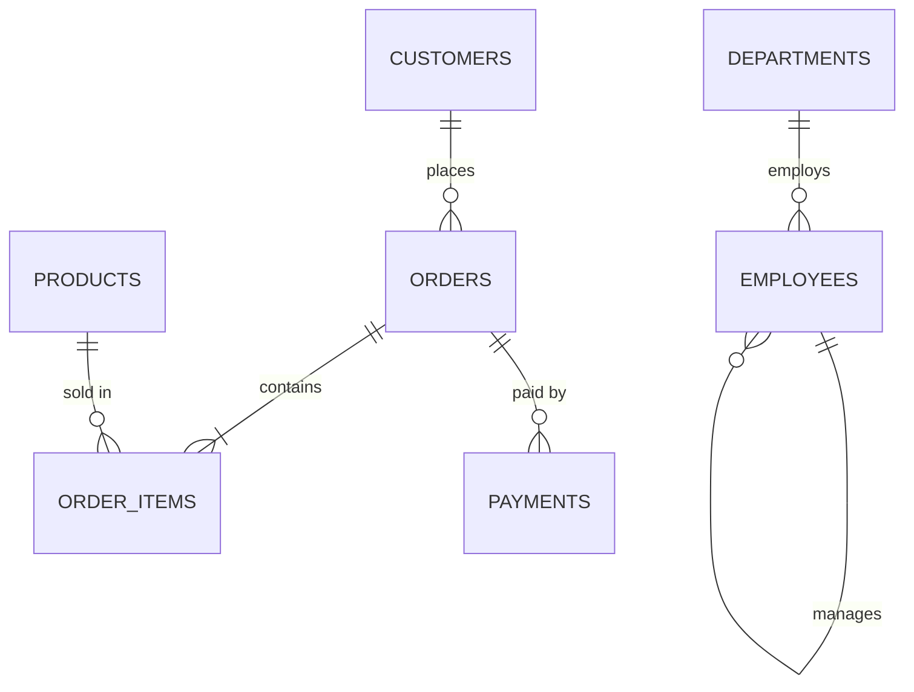

# 150 PostgreSQL Practice Problems

A self-study collection of **150 SQL problems** in three levels: **50 beginner, 50 intermediate and 50 advanced**. Every problem uses the same sample company database, so you can run each query and compare your output with the result shown. All results were produced by running the queries on PostgreSQL 16.

| Level | Topics |
|---|---|
| 🟢 **Beginner** (B01–B50) | `SELECT`, `WHERE`, `ORDER BY`, `LIMIT`/`OFFSET`, `DISTINCT`, aggregates, `GROUP BY`, `HAVING`, `LIKE`/`ILIKE`, `IN`, `BETWEEN`, `NULL` handling, `CASE`, `COALESCE`, basic joins, basic string and date functions, `UNION`, type casting |
| 🟡 **Intermediate** (I01–I50) | Outer, self and cross joins, subqueries (scalar, correlated, `EXISTS`), CTEs, window functions (`ROW_NUMBER`, `RANK`, `DENSE_RANK`, `NTILE`, `LAG`, `LEAD`, `FIRST_VALUE`, running totals, moving averages), `STRING_AGG`, `FILTER`, pivots, string functions (`SPLIT_PART`, `SUBSTRING`, `REGEXP_REPLACE`, `LPAD`, `INITCAP`), dates (`DATE_TRUNC`, `AGE`, `GENERATE_SERIES`), views and temporary views, `INSERT`/`UPDATE`/`DELETE … RETURNING`, `ON CONFLICT`, `INTERSECT`/`EXCEPT` |
| 🔴 **Advanced** (A01–A50) | Recursive CTEs, gaps and islands, window frames (`ROWS`/`RANGE`), `PERCENTILE_CONT`, `MODE`, `GROUPING SETS`, `ROLLUP`, `CUBE`, `LATERAL`, JSON/JSONB, arrays, stored procedures, functions (SQL and PL/pgSQL), triggers, materialized views, temporary tables, `MERGE`, cohort, RFM, Pareto and basket analysis, deduplication, generated columns, constraints, savepoints, sequences, dynamic SQL |

---

## Setup

1. Create the database and load the sample data from [`00_setup.sql`](00_setup.sql):
   ```cmd
   psql -U postgres -d postgres -c "CREATE DATABASE sql_practice;"
   psql -U postgres -d sql_practice -f 00_setup.sql
   ```
2. Run the problems in any order. Each result shown assumes the **original** sample data.

> **Problems that change data or create objects** (`UPDATE`, `DELETE`, `INSERT`, `MERGE`, procedures, triggers, views, sequences, `ALTER TABLE`) were run inside a transaction and rolled back. To keep your data unchanged, wrap them the same way:
> ```sql
> BEGIN;
> -- problem query here
> ROLLBACK;
> ```
> Two problems (A24 and A46) are designed to fail. They show the error raised by a trigger and by a `CHECK` constraint.

## Sample Database

A small company that sells electronics, accessories, furniture and stationery to customers in the Baltic states and Poland.

| Table | Rows | Columns |
|---|---|---|
| `departments` | 6 | dept_id, dept_name, location |
| `employees` | 20 | emp_id, first_name, last_name, email, dept_id, manager_id, job_title, salary, hire_date, city |
| `customers` | 16 | customer_id, first_name, last_name, email, phone, city, country, signup_date |
| `products` | 14 | product_id, product_name, category, price, stock |
| `orders` | 48 | order_id, customer_id, order_date, shipped_date, status, ship_city |
| `order_items` | 80 | order_item_id, order_id, product_id, quantity, unit_price |
| `payments` | 43 | payment_id, order_id, payment_date, amount, method |



Built-in cases to practise on: a department with no employees (Legal), a CEO with no department or manager, customers who never ordered, products never sold, out-of-stock products, missing phone numbers, cancelled orders with no ship date, and one customer registered twice with different email capitalisation.

---

## Contents

### 🟢 Beginner
| | |
|---|---|
| [B01](#b01-list-all-departments) List all departments | [B26](#b26-case-expression) CASE expression |
| [B02](#b02-select-specific-columns) Select specific columns | [B27](#b27-coalesce) COALESCE |
| [B03](#b03-filter-by-a-value) Filter by a value | [B28](#b28-equality-filter-on-numbers) Equality filter on numbers |
| [B04](#b04-filter-and-sort) Filter and sort | [B29](#b29-not-in) NOT IN |
| [B05](#b05-top-n-rows) Top N rows | [B30](#b30-sort-by-two-columns) Sort by two columns |
| [B06](#b06-unique-values) Unique values | [B31](#b31-pagination-with-offset) Pagination with OFFSET |
| [B07](#b07-count-rows) Count rows | [B32](#b32-count-distinct) COUNT DISTINCT |
| [B08](#b08-average) Average | [B33](#b33-inner-join) INNER JOIN |
| [B09](#b09-minimum-and-maximum) Minimum and maximum | [B34](#b34-join-two-tables) Join two tables |
| [B10](#b10-calculated-total) Calculated total | [B35](#b35-filter-on-a-date) Filter on a date |
| [B11](#b11-text-filter) Text filter | [B36](#b36-round-with-arithmetic) ROUND with arithmetic |
| [B12](#b12-between) BETWEEN | [B37](#b37-contains-text) Contains text |
| [B13](#b13-like-pattern) LIKE pattern | [B38](#b38-count-and-sort-groups) Count and sort groups |
| [B14](#b14-case-insensitive-search) Case-insensitive search | [B39](#b39-single-top-row) Single top row |
| [B15](#b15-is-null) IS NULL | [B40](#b40-date-difference) Date difference |
| [B16](#b16-in-list) IN list | [B41](#b41-missing-values) Missing values |
| [B17](#b17-group-by) GROUP BY | [B42](#b42-sum-by-group) SUM by group |
| [B18](#b18-having) HAVING | [B43](#b43-union) UNION |
| [B19](#b19-count-per-group) Count per group | [B44](#b44-not-between) NOT BETWEEN |
| [B20](#b20-extract-year) EXTRACT year | [B45](#b45-left-text-function) LEFT text function |
| [B21](#b21-date-range) Date range | [B46](#b46-having-with-count) HAVING with COUNT |
| [B22](#b22-concatenate-text) Concatenate text | [B47](#b47-average-of-a-column) Average of a column |
| [B23](#b23-upper) UPPER | [B48](#b48-group-by-text-column) Group by text column |
| [B24](#b24-length) LENGTH | [B49](#b49-type-casting) Type casting |
| [B25](#b25-column-alias-and-arithmetic) Column alias and arithmetic | [B50](#b50-format-dates-with-to_char) Format dates with TO_CHAR |

### 🟡 Intermediate
| | |
|---|---|
| [I01](#i01-left-join-to-find-missing-matches) LEFT JOIN to find missing matches | [I26](#i26-lpad) LPAD |
| [I02](#i02-order-totals) Order totals | [I27](#i27-regexp_replace) REGEXP_REPLACE |
| [I03](#i03-top-customers-by-spend) Top customers by spend | [I28](#i28-age) AGE |
| [I04](#i04-revenue-by-category) Revenue by category | [I29](#i29-day-of-week) Day of week |
| [I05](#i05-date_trunc-by-month) DATE_TRUNC by month | [I30](#i30-average-by-group-with-dates) Average by group with dates |
| [I06](#i06-self-join) Self join | [I31](#i31-create-view) CREATE VIEW |
| [I07](#i07-not-exists) NOT EXISTS | [I32](#i32-temporary-view) TEMPORARY VIEW |
| [I08](#i08-subquery-in-where) Subquery in WHERE | [I33](#i33-update-with-returning) UPDATE with RETURNING |
| [I09](#i09-correlated-subquery) Correlated subquery | [I34](#i34-delete-with-returning) DELETE with RETURNING |
| [I10](#i10-full-outer-join) FULL OUTER JOIN | [I35](#i35-insert-with-returning) INSERT with RETURNING |
| [I11](#i11-cross-join) CROSS JOIN | [I36](#i36-upsert-on-conflict) UPSERT (ON CONFLICT) |
| [I12](#i12-basic-cte) Basic CTE | [I37](#i37-intersect) INTERSECT |
| [I13](#i13-multiple-ctes) Multiple CTEs | [I38](#i38-except) EXCEPT |
| [I14](#i14-row_number) ROW_NUMBER | [I39](#i39-union-all-vs-union) UNION ALL vs UNION |
| [I15](#i15-rank) RANK | [I40](#i40-having-with-several-conditions) HAVING with several conditions |
| [I16](#i16-rank-vs-dense_rank) RANK vs DENSE_RANK | [I41](#i41-in-with-subquery) IN with subquery |
| [I17](#i17-running-total) Running total | [I42](#i42-scalar-subquery-in-select) Scalar subquery in SELECT |
| [I18](#i18-lag) LAG | [I43](#i43-distinct-on) DISTINCT ON |
| [I19](#i19-percentage-of-total) Percentage of total | [I44](#i44-ntile) NTILE |
| [I20](#i20-string_agg) STRING_AGG | [I45](#i45-lead) LEAD |
| [I21](#i21-aggregate-filter) Aggregate FILTER | [I46](#i46-first_value) FIRST_VALUE |
| [I22](#i22-pivot-with-case) Pivot with CASE | [I47](#i47-moving-average) Moving average |
| [I23](#i23-split_part) SPLIT_PART | [I48](#i48-generate_series-calendar) GENERATE_SERIES calendar |
| [I24](#i24-substring-and-position) SUBSTRING and POSITION | [I49](#i49-nullif-to-avoid-division-by-zero) NULLIF to avoid division by zero |
| [I25](#i25-clean-text-trim-initcap-replace) Clean text: TRIM, INITCAP, REPLACE | [I50](#i50-four-table-join) Four-table join |

### 🔴 Advanced
| | |
|---|---|
| [A01](#a01-recursive-cte-org-chart) Recursive CTE: org chart | [A26](#a26-temporary-table-as-staging) Temporary table as staging |
| [A02](#a02-recursive-cte-management-chain) Recursive CTE: management chain | [A27](#a27-merge) MERGE |
| [A03](#a03-recursive-cte-number-sequence) Recursive CTE: number sequence | [A28](#a28-window-frame-with-range-and-interval) Window frame with RANGE and INTERVAL |
| [A04](#a04-gaps-and-islands) Gaps and islands | [A29](#a29-cohort-analysis) Cohort analysis |
| [A05](#a05-running-total-that-resets-each-year) Running total that resets each year | [A30](#a30-rfm-segmentation) RFM segmentation |
| [A06](#a06-percent_rank-and-cume_dist) PERCENT_RANK and CUME_DIST | [A31](#a31-pareto-8020-analysis) Pareto (80/20) analysis |
| [A07](#a07-median-with-percentile_cont) Median with PERCENTILE_CONT | [A32](#a32-year-over-year-growth) Year-over-year growth |
| [A08](#a08-mode) MODE() | [A33](#a33-nth-highest-per-group) Nth highest per group |
| [A09](#a09-grouping-sets) GROUPING SETS | [A34](#a34-find-duplicates) Find duplicates |
| [A10](#a10-rollup-with-subtotals) ROLLUP with subtotals | [A35](#a35-remove-duplicates) Remove duplicates |
| [A11](#a11-cube) CUBE | [A36](#a36-median-gap-between-orders) Median gap between orders |
| [A12](#a12-lateral-top-n-per-group) LATERAL: top N per group | [A37](#a37-compare-periods-with-filter) Compare periods with FILTER |
| [A13](#a13-lateral-latest-rows-per-parent) LATERAL: latest rows per parent | [A38](#a38-market-basket-analysis) Market basket analysis |
| [A14](#a14-build-json) Build JSON | [A39](#a39-window-average-vs-row) Window average vs row |
| [A15](#a15-query-jsonb) Query JSONB | [A40](#a40-top-n-with-ties) Top N with ties |
| [A16](#a16-array_agg-and-array-containment) ARRAY_AGG and array containment | [A41](#a41-weekly-date-spine) Weekly date spine |
| [A17](#a17-unnest) UNNEST | [A42](#a42-pivot-with-filter) Pivot with FILTER |
| [A18](#a18-stored-procedure) Stored procedure | [A43](#a43-regexp_match) REGEXP_MATCH |
| [A19](#a19-procedure-with-inout-parameter) Procedure with INOUT parameter | [A44](#a44-format) FORMAT() |
| [A20](#a20-sql-function) SQL function | [A45](#a45-generated-column) Generated column |
| [A21](#a21-function-returning-a-table) Function returning a table | [A46](#a46-check-constraint) CHECK constraint |
| [A22](#a22-function-with-if-logic) Function with IF logic | [A47](#a47-transaction-with-savepoint) Transaction with SAVEPOINT |
| [A23](#a23-audit-trigger) Audit trigger | [A48](#a48-sequence) Sequence |
| [A24](#a24-validation-trigger) Validation trigger | [A49](#a49-dynamic-sql) Dynamic SQL |
| [A25](#a25-materialized-view) Materialized view | [A50](#a50-department-kpi-report) Department KPI report |

---

## 🟢 Beginner

### B01. List all departments

**Problem:** Show every department with its location.

```sql
SELECT dept_id, dept_name, location
FROM departments
ORDER BY dept_id;
```

**Result:**

| dept_id | dept_name | location |
|---|---|---|
| 1 | Sales | Vilnius |
| 2 | Finance | Kaunas |
| 3 | IT | Vilnius |
| 4 | Marketing | Klaipėda |
| 5 | HR | Kaunas |
| 6 | Legal | Vilnius |

---

### B02. Select specific columns

**Problem:** Show each employee's first name, last name and salary.

```sql
SELECT first_name, last_name, salary
FROM employees
ORDER BY emp_id;
```

**Result:**

| first_name | last_name | salary |
|---|---|---|
| Rūta | Kazlauskienė | 9500.00 |
| Tomas | Petrauskas | 6800.00 |
| Ieva | Jankauskaitė | 7200.00 |
| Mantas | Stankevičius | 7800.00 |
| Greta | Vasiliauskaitė | 6500.00 |
| Lukas | Žukauskas | 6000.00 |
| Jonas | Butkus | 4800.00 |
| Agnė | Paulauskaitė | 3200.00 |
| Paulius | Urbonas | 3200.00 |
| Emilija | Kavaliauskaitė | 3400.00 |

*… 20 rows in total*

---

### B03. Filter by a value

**Problem:** List employees who work in the IT department (dept_id = 3).

```sql
SELECT emp_id, first_name, last_name, job_title
FROM employees
WHERE dept_id = 3;
```

**Result:**

| emp_id | first_name | last_name | job_title |
|---|---|---|---|
| 4 | Mantas | Stankevičius | IT Director |
| 14 | Austėja | Mockutė | Data Analyst |
| 15 | Matas | Šimkus | Software Engineer |
| 16 | Gabija | Balčiūnaitė | Software Engineer |
| 17 | Karolis | Jonaitis | Junior Developer |

---

### B04. Filter and sort

**Problem:** Find employees earning more than €5,000, highest salary first.

```sql
SELECT first_name, last_name, salary
FROM employees
WHERE salary > 5000
ORDER BY salary DESC;
```

**Result:**

| first_name | last_name | salary |
|---|---|---|
| Rūta | Kazlauskienė | 9500.00 |
| Mantas | Stankevičius | 7800.00 |
| Ieva | Jankauskaitė | 7200.00 |
| Tomas | Petrauskas | 6800.00 |
| Greta | Vasiliauskaitė | 6500.00 |
| Lukas | Žukauskas | 6000.00 |
| Matas | Šimkus | 5600.00 |
| Gabija | Balčiūnaitė | 5200.00 |

---

### B05. Top N rows

**Problem:** Show the 5 highest-paid employees.

```sql
SELECT first_name, last_name, salary
FROM employees
ORDER BY salary DESC
LIMIT 5;
```

**Result:**

| first_name | last_name | salary |
|---|---|---|
| Rūta | Kazlauskienė | 9500.00 |
| Mantas | Stankevičius | 7800.00 |
| Ieva | Jankauskaitė | 7200.00 |
| Tomas | Petrauskas | 6800.00 |
| Greta | Vasiliauskaitė | 6500.00 |

---

### B06. Unique values

**Problem:** List the distinct countries customers come from.

```sql
SELECT DISTINCT country
FROM customers
ORDER BY country;
```

**Result:**

| country |
|---|
| Estonia |
| Latvia |
| Lithuania |
| Poland |

---

### B07. Count rows

**Problem:** How many employees does the company have?

```sql
SELECT COUNT(*) AS employee_count
FROM employees;
```

**Result:**

| employee_count |
|---|
| 20 |

---

### B08. Average

**Problem:** What is the average employee salary, rounded to 2 decimals?

```sql
SELECT ROUND(AVG(salary), 2) AS avg_salary
FROM employees;
```

**Result:**

| avg_salary |
|---|
| 4925.00 |

---

### B09. Minimum and maximum

**Problem:** Show the lowest and highest salary.

```sql
SELECT MIN(salary) AS min_salary,
       MAX(salary) AS max_salary
FROM employees;
```

**Result:**

| min_salary | max_salary |
|---|---|
| 3000.00 | 9500.00 |

---

### B10. Calculated total

**Problem:** What is the total value of stock (price × stock) across all products?

```sql
SELECT SUM(price * stock) AS stock_value
FROM products;
```

**Result:**

| stock_value |
|---|
| 58470.00 |

---

### B11. Text filter

**Problem:** List all products in the Electronics category.

```sql
SELECT product_name, price
FROM products
WHERE category = 'Electronics'
ORDER BY price DESC;
```

**Result:**

| product_name | price |
|---|---|
| Laptop Pro 14 | 1299.00 |
| Phone Pro 15 | 999.00 |
| Monitor 27 | 289.00 |
| Headphones X2 | 159.00 |
| Webcam HD 1080 | 79.00 |

---

### B12. BETWEEN

**Problem:** Find products priced between €20 and €100.

```sql
SELECT product_name, price
FROM products
WHERE price BETWEEN 20 AND 100
ORDER BY price;
```

**Result:**

| product_name | price |
|---|---|
| Wireless Mouse | 29.90 |
| Desk Lamp | 39.90 |
| USB-C Hub | 45.50 |
| Webcam HD 1080 | 79.00 |
| Mechanical Keyboard | 89.00 |

---

### B13. LIKE pattern

**Problem:** Find customers whose last name starts with 'K'.

```sql
SELECT first_name, last_name
FROM customers
WHERE last_name LIKE 'K%'
ORDER BY last_name;
```

**Result:**

| first_name | last_name |
|---|---|
| Andrius | Kairys |
| Andrius | Kairys |
| Ruta | Kalnina |
| Vaida | Kalvaitienė |
| Mari | Kask |
| Jan | Kowalski |
| Simona | Kriaučiūnė |
| Darius | Kuprys |
| Eglė | Kurtinaitienė |

---

### B14. Case-insensitive search

**Problem:** Find customers with a Gmail address, whatever the letter case.

```sql
SELECT customer_id, email
FROM customers
WHERE email ILIKE '%@gmail.com'
ORDER BY customer_id;
```

**Result:**

| customer_id | email |
|---|---|
| 1 | andrius.kairys@gmail.com |
| 5 | kristjan.tamm@gmail.com |
| 6 | egle.kurt@gmail.com |
| 8 | liga.berzina@gmail.com |
| 11 | vaida.kalv@gmail.com |
| 12 | piotr.z@gmail.com |
| 14 | kestutis.valys@gmail.com |
| 15 | mari.kask@gmail.com |
| 16 | Andrius.Kairys@Gmail.com |

---

### B15. IS NULL

**Problem:** Which employee has no manager?

```sql
SELECT first_name, last_name, job_title
FROM employees
WHERE manager_id IS NULL;
```

**Result:**

| first_name | last_name | job_title |
|---|---|---|
| Rūta | Kazlauskienė | CEO |

---

### B16. IN list

**Problem:** Count orders that are either Shipped or Delivered.

```sql
SELECT COUNT(*) AS shipped_or_delivered
FROM orders
WHERE status IN ('Shipped', 'Delivered');
```

**Result:**

| shipped_or_delivered |
|---|
| 41 |

---

### B17. GROUP BY

**Problem:** Count employees in each department.

```sql
SELECT dept_id, COUNT(*) AS employees
FROM employees
GROUP BY dept_id
ORDER BY dept_id;
```

**Result:**

| dept_id | employees |
|---|---|
| 1 | 5 |
| 2 | 4 |
| 3 | 5 |
| 4 | 3 |
| 5 | 2 |
| NULL | 1 |

---

### B18. HAVING

**Problem:** Show departments whose average salary is above €4,500.

```sql
SELECT dept_id, ROUND(AVG(salary), 2) AS avg_salary
FROM employees
WHERE dept_id IS NOT NULL
GROUP BY dept_id
HAVING AVG(salary) > 4500
ORDER BY avg_salary DESC;
```

**Result:**

| dept_id | avg_salary |
|---|---|
| 3 | 5160.00 |
| 2 | 4725.00 |
| 5 | 4700.00 |

---

### B19. Count per group

**Problem:** How many orders are there in each status?

```sql
SELECT status, COUNT(*) AS orders
FROM orders
GROUP BY status
ORDER BY orders DESC;
```

**Result:**

| status | orders |
|---|---|
| Delivered | 34 |
| Shipped | 7 |
| Cancelled | 5 |
| Returned | 2 |

---

### B20. EXTRACT year

**Problem:** How many orders were placed in 2025?

```sql
SELECT COUNT(*) AS orders_2025
FROM orders
WHERE EXTRACT(YEAR FROM order_date) = 2025;
```

**Result:**

| orders_2025 |
|---|
| 23 |

---

### B21. Date range

**Problem:** List orders placed in March 2025.

```sql
SELECT order_id, customer_id, order_date, status
FROM orders
WHERE order_date BETWEEN '2025-03-01' AND '2025-03-31'
ORDER BY order_date;
```

**Result:**

| order_id | customer_id | order_date | status |
|---|---|---|---|
| 29 | 6 | 2025-03-06 | Delivered |
| 30 | 2 | 2025-03-07 | Cancelled |
| 31 | 2 | 2025-03-12 | Delivered |
| 32 | 8 | 2025-03-22 | Shipped |

---

### B22. Concatenate text

**Problem:** Show each employee's full name in one column.

```sql
SELECT first_name || ' ' || last_name AS full_name
FROM employees
ORDER BY emp_id
LIMIT 5;
```

**Result:**

| full_name |
|---|
| Rūta Kazlauskienė |
| Tomas Petrauskas |
| Ieva Jankauskaitė |
| Mantas Stankevičius |
| Greta Vasiliauskaitė |

---

### B23. UPPER

**Problem:** Show product names in upper case.

```sql
SELECT UPPER(product_name) AS product_upper
FROM products
ORDER BY product_id
LIMIT 5;
```

**Result:**

| product_upper |
|---|
| LAPTOP PRO 14 |
| PHONE PRO 15 |
| MONITOR 27 |
| WIRELESS MOUSE |
| MECHANICAL KEYBOARD |

---

### B24. LENGTH

**Problem:** Which product names are the longest?

```sql
SELECT product_name, LENGTH(product_name) AS name_length
FROM products
ORDER BY name_length DESC
LIMIT 5;
```

**Result:**

| product_name | name_length |
|---|---|
| Mechanical Keyboard | 19 |
| Printer Paper A4 | 16 |
| Wireless Mouse | 14 |
| Webcam HD 1080 | 14 |
| Headphones X2 | 13 |

---

### B25. Column alias and arithmetic

**Problem:** Show each employee's annual salary (12 × monthly).

```sql
SELECT first_name, last_name, salary * 12 AS annual_salary
FROM employees
ORDER BY annual_salary DESC
LIMIT 5;
```

**Result:**

| first_name | last_name | annual_salary |
|---|---|---|
| Rūta | Kazlauskienė | 114000.00 |
| Mantas | Stankevičius | 93600.00 |
| Ieva | Jankauskaitė | 86400.00 |
| Tomas | Petrauskas | 81600.00 |
| Greta | Vasiliauskaitė | 78000.00 |

---

### B26. CASE expression

**Problem:** Label each employee's salary as High (≥ 6000), Medium (≥ 4000) or Low.

```sql
SELECT first_name, salary,
       CASE
           WHEN salary >= 6000 THEN 'High'
           WHEN salary >= 4000 THEN 'Medium'
           ELSE 'Low'
       END AS salary_band
FROM employees
ORDER BY salary DESC
LIMIT 8;
```

**Result:**

| first_name | salary | salary_band |
|---|---|---|
| Rūta | 9500.00 | High |
| Mantas | 7800.00 | High |
| Ieva | 7200.00 | High |
| Tomas | 6800.00 | High |
| Greta | 6500.00 | High |
| Lukas | 6000.00 | High |
| Matas | 5600.00 | Medium |
| Gabija | 5200.00 | Medium |

---

### B27. COALESCE

**Problem:** Show customer phone numbers, displaying 'not provided' when missing.

```sql
SELECT first_name, last_name, COALESCE(phone, 'not provided') AS phone
FROM customers
ORDER BY customer_id
LIMIT 8;
```

**Result:**

| first_name | last_name | phone |
|---|---|---|
| Andrius | Kairys | +370 612 34567 |
| Simona | Kriaučiūnė | +370 698 11223 |
| Marek | Nowak | +48 501 222 333 |
| Anna | Ozola | not provided |
| Kristjan | Tamm | +372 5123 4567 |
| Eglė | Kurtinaitienė | +370 655 99887 |
| Jan | Kowalski | not provided |
| Liga | Berzina | +371 2612 3456 |

---

### B28. Equality filter on numbers

**Problem:** Which products are out of stock?

```sql
SELECT product_name, category
FROM products
WHERE stock = 0;
```

**Result:**

| product_name | category |
|---|---|
| USB-C Hub | Accessories |
| Printer Paper A4 | Stationery |

---

### B29. NOT IN

**Problem:** List products that are not Electronics or Furniture.

```sql
SELECT product_name, category
FROM products
WHERE category NOT IN ('Electronics', 'Furniture')
ORDER BY category, product_name;
```

**Result:**

| product_name | category |
|---|---|
| Mechanical Keyboard | Accessories |
| USB-C Hub | Accessories |
| Wireless Mouse | Accessories |
| Gel Pen Set | Stationery |
| Notebook A5 | Stationery |
| Printer Paper A4 | Stationery |

---

### B30. Sort by two columns

**Problem:** List employees by department, then highest salary first.

```sql
SELECT dept_id, first_name, salary
FROM employees
WHERE dept_id IS NOT NULL
ORDER BY dept_id, salary DESC
LIMIT 8;
```

**Result:**

| dept_id | first_name | salary |
|---|---|---|
| 1 | Tomas | 6800.00 |
| 1 | Jonas | 4800.00 |
| 1 | Emilija | 3400.00 |
| 1 | Agnė | 3200.00 |
| 1 | Paulius | 3200.00 |
| 2 | Ieva | 7200.00 |
| 2 | Domas | 4600.00 |
| 2 | Rokas | 3600.00 |

---

### B31. Pagination with OFFSET

**Problem:** Show the second page of products (5 per page) sorted by name.

```sql
SELECT product_id, product_name
FROM products
ORDER BY product_name
LIMIT 5 OFFSET 5;
```

**Result:**

| product_id | product_name |
|---|---|
| 3 | Monitor 27 |
| 11 | Notebook A5 |
| 8 | Office Chair |
| 2 | Phone Pro 15 |
| 14 | Printer Paper A4 |

---

### B32. COUNT DISTINCT

**Problem:** How many different customers have placed at least one order?

```sql
SELECT COUNT(DISTINCT customer_id) AS ordering_customers
FROM orders;
```

**Result:**

| ordering_customers |
|---|
| 11 |

---

### B33. INNER JOIN

**Problem:** Show each employee with their department name.

```sql
SELECT e.first_name, e.last_name, d.dept_name
FROM employees e
JOIN departments d ON d.dept_id = e.dept_id
ORDER BY d.dept_name, e.last_name
LIMIT 8;
```

**Result:**

| first_name | last_name | dept_name |
|---|---|---|
| Ieva | Jankauskaitė | Finance |
| Domas | Kazlauskas | Finance |
| Laura | Navickaitė | Finance |
| Rokas | Ramanauskas | Finance |
| Viktorija | Žemaitytė | HR |
| Lukas | Žukauskas | HR |
| Gabija | Balčiūnaitė | IT |
| Karolis | Jonaitis | IT |

---

### B34. Join two tables

**Problem:** Show the first 5 orders with the customer's full name.

```sql
SELECT o.order_id, o.order_date, c.first_name || ' ' || c.last_name AS customer
FROM orders o
JOIN customers c ON c.customer_id = o.customer_id
ORDER BY o.order_id
LIMIT 5;
```

**Result:**

| order_id | order_date | customer |
|---|---|---|
| 1 | 2024-02-10 | Andrius Kairys |
| 2 | 2024-02-19 | Andrius Kairys |
| 3 | 2024-02-21 | Marek Nowak |
| 4 | 2024-02-22 | Darius Kuprys |
| 5 | 2024-03-02 | Marek Nowak |

---

### B35. Filter on a date

**Problem:** List employees hired in 2022 or later.

```sql
SELECT first_name, last_name, hire_date
FROM employees
WHERE hire_date >= '2022-01-01'
ORDER BY hire_date;
```

**Result:**

| first_name | last_name | hire_date |
|---|---|---|
| Paulius | Urbonas | 2022-03-01 |
| Gabija | Balčiūnaitė | 2022-06-20 |
| Laura | Navickaitė | 2022-09-05 |
| Deividas | Bružas | 2022-11-21 |
| Ugnė | Lukoševičiūtė | 2023-03-13 |
| Viktorija | Žemaitytė | 2023-08-28 |
| Karolis | Jonaitis | 2024-01-08 |

---

### B36. ROUND with arithmetic

**Problem:** Show product prices including 21% VAT.

```sql
SELECT product_name, price, ROUND(price * 1.21, 2) AS price_with_vat
FROM products
ORDER BY product_id
LIMIT 5;
```

**Result:**

| product_name | price | price_with_vat |
|---|---|---|
| Laptop Pro 14 | 1299.00 | 1571.79 |
| Phone Pro 15 | 999.00 | 1208.79 |
| Monitor 27 | 289.00 | 349.69 |
| Wireless Mouse | 29.90 | 36.18 |
| Mechanical Keyboard | 89.00 | 107.69 |

---

### B37. Contains text

**Problem:** Find products whose name contains 'Pro'.

```sql
SELECT product_name, price
FROM products
WHERE product_name LIKE '%Pro%';
```

**Result:**

| product_name | price |
|---|---|
| Laptop Pro 14 | 1299.00 |
| Phone Pro 15 | 999.00 |

---

### B38. Count and sort groups

**Problem:** How many customers are there per country?

```sql
SELECT country, COUNT(*) AS customers
FROM customers
GROUP BY country
ORDER BY customers DESC, country;
```

**Result:**

| country | customers |
|---|---|
| Lithuania | 7 |
| Estonia | 3 |
| Latvia | 3 |
| Poland | 3 |

---

### B39. Single top row

**Problem:** What is the most expensive product?

```sql
SELECT product_name, price
FROM products
ORDER BY price DESC
LIMIT 1;
```

**Result:**

| product_name | price |
|---|---|
| Laptop Pro 14 | 1299.00 |

---

### B40. Date difference

**Problem:** How many days did each shipped order take to ship? Show the first 5.

```sql
SELECT order_id, order_date, shipped_date,
       shipped_date - order_date AS days_to_ship
FROM orders
WHERE shipped_date IS NOT NULL
ORDER BY order_id
LIMIT 5;
```

**Result:**

| order_id | order_date | shipped_date | days_to_ship |
|---|---|---|---|
| 1 | 2024-02-10 | 2024-02-12 | 2 |
| 2 | 2024-02-19 | 2024-02-25 | 6 |
| 3 | 2024-02-21 | 2024-02-27 | 6 |
| 4 | 2024-02-22 | 2024-02-23 | 1 |
| 6 | 2024-03-03 | 2024-03-06 | 3 |

---

### B41. Missing values

**Problem:** List orders that were never shipped.

```sql
SELECT order_id, order_date, status
FROM orders
WHERE shipped_date IS NULL
ORDER BY order_id;
```

**Result:**

| order_id | order_date | status |
|---|---|---|
| 5 | 2024-03-02 | Cancelled |
| 8 | 2024-03-14 | Cancelled |
| 10 | 2024-03-31 | Cancelled |
| 17 | 2024-06-05 | Cancelled |
| 30 | 2025-03-07 | Cancelled |

---

### B42. SUM by group

**Problem:** What is the total amount paid with each payment method?

```sql
SELECT method, SUM(amount) AS total_paid
FROM payments
GROUP BY method
ORDER BY total_paid DESC;
```

**Result:**

| method | total_paid |
|---|---|
| Card | 10798.00 |
| PayPal | 8312.60 |
| Apple Pay | 2291.20 |
| Bank Transfer | 834.90 |

---

### B43. UNION

**Problem:** List every city that has a customer or an employee (no duplicates).

```sql
SELECT city FROM customers
UNION
SELECT city FROM employees
ORDER BY city;
```

**Result:**

| city |
|---|
| Gdansk |
| Kaunas |
| Klaipėda |
| Krakow |
| Panevėžys |
| Riga |
| Tallinn |
| Tartu |
| Vilnius |
| Warsaw |

*… 11 rows in total*

---

### B44. NOT BETWEEN

**Problem:** Find employees whose salary is not between €3,500 and €6,000.

```sql
SELECT first_name, salary
FROM employees
WHERE salary NOT BETWEEN 3500 AND 6000
ORDER BY salary;
```

**Result:**

| first_name | salary |
|---|---|
| Karolis | 3000.00 |
| Agnė | 3200.00 |
| Paulius | 3200.00 |
| Ugnė | 3300.00 |
| Viktorija | 3400.00 |
| Emilija | 3400.00 |
| Greta | 6500.00 |
| Tomas | 6800.00 |
| Ieva | 7200.00 |
| Mantas | 7800.00 |

*… 11 rows in total*

---

### B45. LEFT text function

**Problem:** Show the first three letters of each customer's last name.

```sql
SELECT last_name, LEFT(last_name, 3) AS short_name
FROM customers
ORDER BY customer_id
LIMIT 5;
```

**Result:**

| last_name | short_name |
|---|---|
| Kairys | Kai |
| Kriaučiūnė | Kri |
| Nowak | Now |
| Ozola | Ozo |
| Tamm | Tam |

---

### B46. HAVING with COUNT

**Problem:** Which product categories have more than 3 products?

```sql
SELECT category, COUNT(*) AS products
FROM products
GROUP BY category
HAVING COUNT(*) > 3
ORDER BY products DESC;
```

**Result:**

| category | products |
|---|---|
| Electronics | 5 |

---

### B47. Average of a column

**Problem:** What is the average quantity per order line?

```sql
SELECT ROUND(AVG(quantity), 2) AS avg_quantity
FROM order_items;
```

**Result:**

| avg_quantity |
|---|
| 1.35 |

---

### B48. Group by text column

**Problem:** How many employees hold each job title? Show titles held by more than one person.

```sql
SELECT job_title, COUNT(*) AS employees
FROM employees
GROUP BY job_title
HAVING COUNT(*) > 1
ORDER BY employees DESC;
```

**Result:**

| job_title | employees |
|---|---|
| Sales Representative | 3 |
| Software Engineer | 2 |

---

### B49. Type casting

**Problem:** Show each product price as a whole number and as text with a € sign.

```sql
SELECT product_name,
       price::INT AS price_rounded,
       '€' || price::TEXT AS price_label
FROM products
ORDER BY product_id
LIMIT 5;
```

**Result:**

| product_name | price_rounded | price_label |
|---|---|---|
| Laptop Pro 14 | 1299 | €1299.00 |
| Phone Pro 15 | 999 | €999.00 |
| Monitor 27 | 289 | €289.00 |
| Wireless Mouse | 30 | €29.90 |
| Mechanical Keyboard | 89 | €89.00 |

---

### B50. Format dates with TO_CHAR

**Problem:** Show order dates in the format 'DD Mon YYYY'.

```sql
SELECT order_id, TO_CHAR(order_date, 'DD Mon YYYY') AS order_day
FROM orders
ORDER BY order_id
LIMIT 5;
```

**Result:**

| order_id | order_day |
|---|---|
| 1 | 10 Feb 2024 |
| 2 | 19 Feb 2024 |
| 3 | 21 Feb 2024 |
| 4 | 22 Feb 2024 |
| 5 | 02 Mar 2024 |

---


## 🟡 Intermediate

### I01. LEFT JOIN to find missing matches

**Problem:** Which customers have never placed an order?

```sql
SELECT c.customer_id, c.first_name, c.last_name
FROM customers c
LEFT JOIN orders o ON o.customer_id = c.customer_id
WHERE o.order_id IS NULL
ORDER BY c.customer_id;
```

**Result:**

| customer_id | first_name | last_name |
|---|---|---|
| 10 | Kaisa | Saar |
| 11 | Vaida | Kalvaitienė |
| 13 | Ruta | Kalnina |
| 15 | Mari | Kask |
| 16 | Andrius | Kairys |

---

### I02. Order totals

**Problem:** Calculate the total value of each order. Show the 5 largest.

```sql
SELECT order_id, SUM(quantity * unit_price) AS order_total
FROM order_items
GROUP BY order_id
ORDER BY order_total DESC
LIMIT 5;
```

**Result:**

| order_id | order_total |
|---|---|
| 20 | 1676.00 |
| 31 | 1588.00 |
| 12 | 1548.00 |
| 33 | 1378.80 |
| 43 | 1273.90 |

---

### I03. Top customers by spend

**Problem:** Who are the top 5 customers by total spend (excluding cancelled orders)?

```sql
SELECT c.first_name || ' ' || c.last_name AS customer,
       SUM(oi.quantity * oi.unit_price) AS total_spend
FROM customers c
JOIN orders o       ON o.customer_id = c.customer_id
JOIN order_items oi ON oi.order_id = o.order_id
WHERE o.status <> 'Cancelled'
GROUP BY c.customer_id, customer
ORDER BY total_spend DESC
LIMIT 5;
```

**Result:**

| customer | total_spend |
|---|---|
| Simona Kriaučiūnė | 5292.70 |
| Andrius Kairys | 2698.60 |
| Marek Nowak | 2461.30 |
| Kristjan Tamm | 2148.00 |
| Jan Kowalski | 2027.90 |

---

### I04. Revenue by category

**Problem:** What is the revenue per product category?

```sql
SELECT p.category, SUM(oi.quantity * oi.unit_price) AS revenue
FROM order_items oi
JOIN products p ON p.product_id = oi.product_id
JOIN orders o   ON o.order_id = oi.order_id
WHERE o.status <> 'Cancelled'
GROUP BY p.category
ORDER BY revenue DESC;
```

**Result:**

| category | revenue |
|---|---|
| Electronics | 12971.00 |
| Furniture | 6753.70 |
| Accessories | 2415.10 |
| Stationery | 96.90 |

---

### I05. DATE_TRUNC by month

**Problem:** Show revenue per month for the first 6 months of 2025.

```sql
SELECT DATE_TRUNC('month', o.order_date)::DATE AS month,
       SUM(oi.quantity * oi.unit_price) AS revenue
FROM orders o
JOIN order_items oi ON oi.order_id = o.order_id
WHERE o.status <> 'Cancelled'
  AND o.order_date BETWEEN '2025-01-01' AND '2025-06-30'
GROUP BY month
ORDER BY month;
```

**Result:**

| month | revenue |
|---|---|
| 2025-01-01 | 4.50 |
| 2025-02-01 | 488.50 |
| 2025-03-01 | 2103.90 |
| 2025-06-01 | 1378.80 |

---

### I06. Self join

**Problem:** Show each employee next to their manager's name.

```sql
SELECT e.first_name || ' ' || e.last_name AS employee,
       m.first_name || ' ' || m.last_name AS manager
FROM employees e
LEFT JOIN employees m ON m.emp_id = e.manager_id
ORDER BY e.emp_id
LIMIT 8;
```

**Result:**

| employee | manager |
|---|---|
| Rūta Kazlauskienė | NULL |
| Tomas Petrauskas | Rūta Kazlauskienė |
| Ieva Jankauskaitė | Rūta Kazlauskienė |
| Mantas Stankevičius | Rūta Kazlauskienė |
| Greta Vasiliauskaitė | Rūta Kazlauskienė |
| Lukas Žukauskas | Rūta Kazlauskienė |
| Jonas Butkus | Tomas Petrauskas |
| Agnė Paulauskaitė | Jonas Butkus |

---

### I07. NOT EXISTS

**Problem:** Which products have never been ordered?

```sql
SELECT p.product_id, p.product_name
FROM products p
WHERE NOT EXISTS (
    SELECT 1 FROM order_items oi WHERE oi.product_id = p.product_id
);
```

**Result:**

| product_id | product_name |
|---|---|
| 13 | Webcam HD 1080 |
| 14 | Printer Paper A4 |

---

### I08. Subquery in WHERE

**Problem:** Which employees earn more than the company average?

```sql
SELECT first_name, last_name, salary
FROM employees
WHERE salary > (SELECT AVG(salary) FROM employees)
ORDER BY salary DESC;
```

**Result:**

| first_name | last_name | salary |
|---|---|---|
| Rūta | Kazlauskienė | 9500.00 |
| Mantas | Stankevičius | 7800.00 |
| Ieva | Jankauskaitė | 7200.00 |
| Tomas | Petrauskas | 6800.00 |
| Greta | Vasiliauskaitė | 6500.00 |
| Lukas | Žukauskas | 6000.00 |
| Matas | Šimkus | 5600.00 |
| Gabija | Balčiūnaitė | 5200.00 |

---

### I09. Correlated subquery

**Problem:** Which employees earn more than the average of their own department?

```sql
SELECT e.first_name, e.dept_id, e.salary
FROM employees e
WHERE e.salary > (
    SELECT AVG(e2.salary) FROM employees e2 WHERE e2.dept_id = e.dept_id
)
ORDER BY e.dept_id;
```

**Result:**

| first_name | dept_id | salary |
|---|---|---|
| Tomas | 1 | 6800.00 |
| Jonas | 1 | 4800.00 |
| Ieva | 2 | 7200.00 |
| Gabija | 3 | 5200.00 |
| Mantas | 3 | 7800.00 |
| Matas | 3 | 5600.00 |
| Greta | 4 | 6500.00 |
| Lukas | 5 | 6000.00 |

---

### I10. FULL OUTER JOIN

**Problem:** Show all departments and employees, including departments with no staff and staff with no department.

```sql
SELECT d.dept_name, e.first_name, e.job_title
FROM departments d
FULL OUTER JOIN employees e ON e.dept_id = d.dept_id
WHERE d.dept_id IS NULL OR e.emp_id IS NULL;
```

**Result:**

| dept_name | first_name | job_title |
|---|---|---|
| NULL | Rūta | CEO |
| Legal | NULL | NULL |

---

### I11. CROSS JOIN

**Problem:** Create every combination of department and year (2024, 2025) for a reporting template.

```sql
SELECT d.dept_name, y.year
FROM departments d
CROSS JOIN (VALUES (2024), (2025)) AS y(year)
ORDER BY d.dept_id, y.year
LIMIT 6;
```

**Result:**

| dept_name | year |
|---|---|
| Sales | 2024 |
| Sales | 2025 |
| Finance | 2024 |
| Finance | 2025 |
| IT | 2024 |
| IT | 2025 |

---

### I12. Basic CTE

**Problem:** Using a CTE, list customers who have spent more than €2,000.

```sql
WITH customer_spend AS (
    SELECT o.customer_id, SUM(oi.quantity * oi.unit_price) AS spend
    FROM orders o
    JOIN order_items oi ON oi.order_id = o.order_id
    WHERE o.status <> 'Cancelled'
    GROUP BY o.customer_id
)
SELECT c.first_name, c.last_name, cs.spend
FROM customer_spend cs
JOIN customers c ON c.customer_id = cs.customer_id
WHERE cs.spend > 2000
ORDER BY cs.spend DESC;
```

**Result:**

| first_name | last_name | spend |
|---|---|---|
| Simona | Kriaučiūnė | 5292.70 |
| Andrius | Kairys | 2698.60 |
| Marek | Nowak | 2461.30 |
| Kristjan | Tamm | 2148.00 |
| Jan | Kowalski | 2027.90 |

---

### I13. Multiple CTEs

**Problem:** Compare each 2025 month's revenue with the 2025 monthly average.

```sql
WITH monthly AS (
    SELECT DATE_TRUNC('month', o.order_date)::DATE AS month,
           SUM(oi.quantity * oi.unit_price) AS revenue
    FROM orders o
    JOIN order_items oi ON oi.order_id = o.order_id
    WHERE o.status <> 'Cancelled' AND EXTRACT(YEAR FROM o.order_date) = 2025
    GROUP BY month
),
avg_month AS (
    SELECT AVG(revenue) AS avg_revenue FROM monthly
)
SELECT m.month, m.revenue,
       ROUND(m.revenue - a.avg_revenue, 2) AS diff_from_avg
FROM monthly m CROSS JOIN avg_month a
ORDER BY m.month
LIMIT 6;
```

**Result:**

| month | revenue | diff_from_avg |
|---|---|---|
| 2025-01-01 | 4.50 | -1552.60 |
| 2025-02-01 | 488.50 | -1068.60 |
| 2025-03-01 | 2103.90 | 546.80 |
| 2025-06-01 | 1378.80 | -178.30 |
| 2025-07-01 | 3125.60 | 1568.50 |
| 2025-08-01 | 2340.90 | 783.80 |

---

### I14. ROW_NUMBER

**Problem:** Number employees within each department from highest to lowest salary.

```sql
SELECT dept_id, first_name, salary,
       ROW_NUMBER() OVER (PARTITION BY dept_id ORDER BY salary DESC) AS rn
FROM employees
WHERE dept_id IN (1, 3)
ORDER BY dept_id, rn;
```

**Result:**

| dept_id | first_name | salary | rn |
|---|---|---|---|
| 1 | Tomas | 6800.00 | 1 |
| 1 | Jonas | 4800.00 | 2 |
| 1 | Emilija | 3400.00 | 3 |
| 1 | Paulius | 3200.00 | 4 |
| 1 | Agnė | 3200.00 | 5 |
| 3 | Mantas | 7800.00 | 1 |
| 3 | Matas | 5600.00 | 2 |
| 3 | Gabija | 5200.00 | 3 |
| 3 | Austėja | 4200.00 | 4 |
| 3 | Karolis | 3000.00 | 5 |

---

### I15. RANK

**Problem:** Rank products from most to least expensive.

```sql
SELECT product_name, price,
       RANK() OVER (ORDER BY price DESC) AS price_rank
FROM products
LIMIT 6;
```

**Result:**

| product_name | price | price_rank |
|---|---|---|
| Laptop Pro 14 | 1299.00 | 1 |
| Phone Pro 15 | 999.00 | 2 |
| Standing Desk | 499.00 | 3 |
| Monitor 27 | 289.00 | 4 |
| Office Chair | 249.00 | 5 |
| Headphones X2 | 159.00 | 6 |

---

### I16. RANK vs DENSE_RANK

**Problem:** Rank Sales employees by salary and compare RANK with DENSE_RANK on ties.

```sql
SELECT first_name, salary,
       RANK()       OVER (ORDER BY salary DESC) AS rnk,
       DENSE_RANK() OVER (ORDER BY salary DESC) AS dense_rnk
FROM employees
WHERE dept_id = 1;
```

**Result:**

| first_name | salary | rnk | dense_rnk |
|---|---|---|---|
| Tomas | 6800.00 | 1 | 1 |
| Jonas | 4800.00 | 2 | 2 |
| Emilija | 3400.00 | 3 | 3 |
| Agnė | 3200.00 | 4 | 4 |
| Paulius | 3200.00 | 4 | 4 |

---

### I17. Running total

**Problem:** Show a running total of payments in date order (first 8 payments).

```sql
SELECT payment_date, amount,
       SUM(amount) OVER (ORDER BY payment_date, payment_id) AS running_total
FROM payments
ORDER BY payment_date, payment_id
LIMIT 8;
```

**Result:**

| payment_date | amount | running_total |
|---|---|---|
| 2024-02-10 | 499.00 | 499.00 |
| 2024-02-21 | 294.50 | 793.50 |
| 2024-02-22 | 159.00 | 952.50 |
| 2024-02-23 | 1038.90 | 1991.40 |
| 2024-03-05 | 45.50 | 2036.90 |
| 2024-03-08 | 98.00 | 2134.90 |
| 2024-03-17 | 89.00 | 2223.90 |
| 2024-04-06 | 1103.00 | 3326.90 |

---

### I18. LAG

**Problem:** Show month-over-month revenue change for 2025.

```sql
WITH monthly AS (
    SELECT DATE_TRUNC('month', o.order_date)::DATE AS month,
           SUM(oi.quantity * oi.unit_price) AS revenue
    FROM orders o
    JOIN order_items oi ON oi.order_id = o.order_id
    WHERE o.status <> 'Cancelled' AND o.order_date >= '2025-01-01'
    GROUP BY month
)
SELECT month, revenue,
       LAG(revenue) OVER (ORDER BY month) AS prev_month,
       revenue - LAG(revenue) OVER (ORDER BY month) AS change
FROM monthly
ORDER BY month
LIMIT 6;
```

**Result:**

| month | revenue | prev_month | change |
|---|---|---|---|
| 2025-01-01 | 4.50 | NULL | NULL |
| 2025-02-01 | 488.50 | 4.50 | 484.00 |
| 2025-03-01 | 2103.90 | 488.50 | 1615.40 |
| 2025-06-01 | 1378.80 | 2103.90 | -725.10 |
| 2025-07-01 | 3125.60 | 1378.80 | 1746.80 |
| 2025-08-01 | 2340.90 | 3125.60 | -784.70 |

---

### I19. Percentage of total

**Problem:** What share of total revenue does each category contribute?

```sql
SELECT p.category,
       SUM(oi.quantity * oi.unit_price) AS revenue,
       ROUND(100.0 * SUM(oi.quantity * oi.unit_price)
             / SUM(SUM(oi.quantity * oi.unit_price)) OVER (), 1) AS pct_of_total
FROM order_items oi
JOIN products p ON p.product_id = oi.product_id
GROUP BY p.category
ORDER BY revenue DESC;
```

**Result:**

| category | revenue | pct_of_total |
|---|---|---|
| Electronics | 13260.00 | 57.5 |
| Furniture | 7251.70 | 31.4 |
| Accessories | 2445.00 | 10.6 |
| Stationery | 105.90 | 0.5 |

---

### I20. STRING_AGG

**Problem:** List the employees of each department in one comma-separated column.

```sql
SELECT d.dept_name,
       STRING_AGG(e.first_name, ', ' ORDER BY e.first_name) AS employees
FROM departments d
JOIN employees e ON e.dept_id = d.dept_id
GROUP BY d.dept_name
ORDER BY d.dept_name;
```

**Result:**

| dept_name | employees |
|---|---|
| Finance | Domas, Ieva, Laura, Rokas |
| HR | Lukas, Viktorija |
| IT | Austėja, Gabija, Karolis, Mantas, Matas |
| Marketing | Deividas, Greta, Ugnė |
| Sales | Agnė, Emilija, Jonas, Paulius, Tomas |

---

### I21. Aggregate FILTER

**Problem:** For each customer, count delivered and cancelled orders in separate columns.

```sql
SELECT customer_id,
       COUNT(*) FILTER (WHERE status = 'Delivered') AS delivered,
       COUNT(*) FILTER (WHERE status = 'Cancelled') AS cancelled,
       COUNT(*) AS total_orders
FROM orders
GROUP BY customer_id
ORDER BY total_orders DESC
LIMIT 6;
```

**Result:**

| customer_id | delivered | cancelled | total_orders |
|---|---|---|---|
| 1 | 7 | 1 | 9 |
| 3 | 5 | 1 | 7 |
| 5 | 5 | 0 | 6 |
| 2 | 5 | 1 | 6 |
| 4 | 2 | 1 | 4 |
| 6 | 3 | 0 | 4 |

---

### I22. Pivot with CASE

**Problem:** Show each category's revenue for 2024 and 2025 side by side.

```sql
SELECT p.category,
       SUM(CASE WHEN EXTRACT(YEAR FROM o.order_date) = 2024 THEN oi.quantity * oi.unit_price ELSE 0 END) AS rev_2024,
       SUM(CASE WHEN EXTRACT(YEAR FROM o.order_date) = 2025 THEN oi.quantity * oi.unit_price ELSE 0 END) AS rev_2025
FROM order_items oi
JOIN orders o   ON o.order_id = oi.order_id
JOIN products p ON p.product_id = oi.product_id
WHERE o.status <> 'Cancelled'
GROUP BY p.category
ORDER BY p.category;
```

**Result:**

| category | rev_2024 | rev_2025 |
|---|---|---|
| Accessories | 1370.30 | 1044.80 |
| Electronics | 4773.00 | 8198.00 |
| Furniture | 3610.70 | 3143.00 |
| Stationery | 25.90 | 71.00 |

---

### I23. SPLIT_PART

**Problem:** Count customers by email domain.

```sql
SELECT LOWER(SPLIT_PART(email, '@', 2)) AS domain, COUNT(*) AS customers
FROM customers
GROUP BY domain
ORDER BY customers DESC, domain;
```

**Result:**

| domain | customers |
|---|---|
| gmail.com | 9 |
| inbox.lv | 2 |
| outlook.com | 2 |
| onet.pl | 1 |
| wp.pl | 1 |
| yahoo.com | 1 |

---

### I24. SUBSTRING and POSITION

**Problem:** Extract the username (the part before '@') from customer emails.

```sql
SELECT email,
       SUBSTRING(email FROM 1 FOR POSITION('@' IN email) - 1) AS username
FROM customers
ORDER BY customer_id
LIMIT 5;
```

**Result:**

| email | username |
|---|---|
| andrius.kairys@gmail.com | andrius.kairys |
| simona.k@yahoo.com | simona.k |
| marek.nowak@wp.pl | marek.nowak |
| anna.ozola@inbox.lv | anna.ozola |
| kristjan.tamm@gmail.com | kristjan.tamm |

---

### I25. Clean text: TRIM, INITCAP, REPLACE

**Problem:** Clean a list of messy city names.

```sql
SELECT raw_city,
       INITCAP(TRIM(REPLACE(raw_city, '_', ' '))) AS clean_city
FROM (VALUES ('  vilnius '), ('KAUNAS'), ('klaipeda_city'), (' panevezys')) AS t(raw_city);
```

**Result:**

| raw_city | clean_city |
|---|---|
|   vilnius  | Vilnius |
| KAUNAS | Kaunas |
| klaipeda_city | Klaipeda City |
|  panevezys | Panevezys |

---

### I26. LPAD

**Problem:** Format order IDs as invoice numbers like INV-00001.

```sql
SELECT order_id, 'INV-' || LPAD(order_id::TEXT, 5, '0') AS invoice_no
FROM orders
ORDER BY order_id
LIMIT 5;
```

**Result:**

| order_id | invoice_no |
|---|---|
| 1 | INV-00001 |
| 2 | INV-00002 |
| 3 | INV-00003 |
| 4 | INV-00004 |
| 5 | INV-00005 |

---

### I27. REGEXP_REPLACE

**Problem:** Keep only the digits in each customer phone number.

```sql
SELECT phone, REGEXP_REPLACE(phone, '[^0-9]', '', 'g') AS digits_only
FROM customers
WHERE phone IS NOT NULL
ORDER BY customer_id
LIMIT 5;
```

**Result:**

| phone | digits_only |
|---|---|
| +370 612 34567 | 37061234567 |
| +370 698 11223 | 37069811223 |
| +48 501 222 333 | 48501222333 |
| +372 5123 4567 | 37251234567 |
| +370 655 99887 | 37065599887 |

---

### I28. AGE

**Problem:** How long had each director worked at the company on 31 December 2025?

```sql
SELECT first_name, hire_date,
       AGE(DATE '2025-12-31', hire_date) AS tenure
FROM employees
WHERE job_title LIKE '%Director%'
ORDER BY hire_date;
```

**Result:**

| first_name | hire_date | tenure |
|---|---|---|
| Tomas | 2016-06-15 | 3481 days, 0:00:00 |
| Mantas | 2016-09-01 | 3405 days, 0:00:00 |
| Ieva | 2017-01-10 | 3271 days, 0:00:00 |
| Greta | 2018-04-23 | 2803 days, 0:00:00 |
| Lukas | 2019-02-11 | 2510 days, 0:00:00 |

---

### I29. Day of week

**Problem:** On which day of the week are most orders placed?

```sql
SELECT TO_CHAR(order_date, 'Day') AS weekday,
       EXTRACT(ISODOW FROM order_date) AS day_no,
       COUNT(*) AS orders
FROM orders
GROUP BY weekday, day_no
ORDER BY day_no;
```

**Result:**

| weekday | day_no | orders |
|---|---|---|
| Monday    | 1 | 6 |
| Tuesday   | 2 | 1 |
| Wednesday | 3 | 9 |
| Thursday  | 4 | 11 |
| Friday    | 5 | 7 |
| Saturday  | 6 | 8 |
| Sunday    | 7 | 6 |

---

### I30. Average by group with dates

**Problem:** What is the average number of days to ship, by shipping country?

```sql
SELECT c.country,
       ROUND(AVG(o.shipped_date - o.order_date), 1) AS avg_days_to_ship
FROM orders o
JOIN customers c ON c.customer_id = o.customer_id
WHERE o.shipped_date IS NOT NULL
GROUP BY c.country
ORDER BY avg_days_to_ship;
```

**Result:**

| country | avg_days_to_ship |
|---|---|
| Estonia | 2.7 |
| Lithuania | 3.0 |
| Latvia | 3.5 |
| Poland | 4.3 |

---

### I31. CREATE VIEW

**Problem:** Create a view with one row per order and its total, then query it.

```sql
CREATE OR REPLACE VIEW v_order_totals AS
SELECT o.order_id, o.customer_id, o.order_date, o.status,
       SUM(oi.quantity * oi.unit_price) AS order_total
FROM orders o
JOIN order_items oi ON oi.order_id = o.order_id
GROUP BY o.order_id;

SELECT status, COUNT(*) AS orders, SUM(order_total) AS value
FROM v_order_totals
GROUP BY status
ORDER BY value DESC;
```

**Result:**

| status | orders | value |
|---|---|---|
| Delivered | 34 | 16888.40 |
| Shipped | 7 | 4601.50 |
| Cancelled | 5 | 825.90 |
| Returned | 2 | 746.80 |

---

### I32. TEMPORARY VIEW

**Problem:** Create a temporary view of high-value orders (over €1,000) for this session only.

```sql
CREATE TEMP VIEW tmp_big_orders AS
SELECT o.order_id, o.order_date, SUM(oi.quantity * oi.unit_price) AS order_total
FROM orders o
JOIN order_items oi ON oi.order_id = o.order_id
GROUP BY o.order_id
HAVING SUM(oi.quantity * oi.unit_price) > 1000;

SELECT COUNT(*) AS big_orders, ROUND(AVG(order_total), 2) AS avg_value
FROM tmp_big_orders;
```

**Result:**

| big_orders | avg_value |
|---|---|
| 8 | 1329.44 |

---

### I33. UPDATE with RETURNING

**Problem:** Give the IT department a 5% raise and show the new salaries.

```sql
UPDATE employees
SET salary = ROUND(salary * 1.05, 2)
WHERE dept_id = 3
RETURNING first_name, salary AS new_salary;
```

**Result:**

| first_name | new_salary |
|---|---|
| Mantas | 8190.00 |
| Austėja | 4410.00 |
| Matas | 5880.00 |
| Gabija | 5460.00 |
| Karolis | 3150.00 |

---

### I34. DELETE with RETURNING

**Problem:** Delete cancelled orders and show which ones were removed.

```sql
DELETE FROM orders
WHERE status = 'Cancelled'
RETURNING order_id, order_date, status;
```

**Result:**

| order_id | order_date | status |
|---|---|---|
| 5 | 2024-03-02 | Cancelled |
| 8 | 2024-03-14 | Cancelled |
| 10 | 2024-03-31 | Cancelled |
| 17 | 2024-06-05 | Cancelled |
| 30 | 2025-03-07 | Cancelled |

---

### I35. INSERT with RETURNING

**Problem:** Add a new product and return its row.

```sql
INSERT INTO products (product_id, product_name, category, price, stock)
VALUES (15, 'Laptop Stand', 'Accessories', 34.90, 40)
RETURNING *;
```

**Result:**

| product_id | product_name | category | price | stock |
|---|---|---|---|---|
| 15 | Laptop Stand | Accessories | 34.90 | 40 |

---

### I36. UPSERT (ON CONFLICT)

**Problem:** Insert a product, or add to its stock if the ID already exists.

```sql
INSERT INTO products (product_id, product_name, category, price, stock)
VALUES (4, 'Wireless Mouse', 'Accessories', 29.90, 50)
ON CONFLICT (product_id)
DO UPDATE SET stock = products.stock + EXCLUDED.stock
RETURNING product_id, product_name, stock;
```

**Result:**

| product_id | product_name | stock |
|---|---|---|
| 4 | Wireless Mouse | 200 |

---

### I37. INTERSECT

**Problem:** Which customers ordered in both 2024 and 2025?

```sql
SELECT customer_id FROM orders WHERE EXTRACT(YEAR FROM order_date) = 2024
INTERSECT
SELECT customer_id FROM orders WHERE EXTRACT(YEAR FROM order_date) = 2025
ORDER BY customer_id;
```

**Result:**

| customer_id |
|---|
| 1 |
| 2 |
| 3 |
| 4 |
| 5 |
| 6 |
| 7 |
| 8 |
| 9 |
| 12 |

---

### I38. EXCEPT

**Problem:** Which customers placed their first-ever orders in 2025 (ordered in 2025 but not in 2024)?

```sql
SELECT customer_id FROM orders WHERE EXTRACT(YEAR FROM order_date) = 2025
EXCEPT
SELECT customer_id FROM orders WHERE EXTRACT(YEAR FROM order_date) = 2024
ORDER BY customer_id;
```

**Result:**

| customer_id |
|---|
| 14 |

---

### I39. UNION ALL vs UNION

**Problem:** Compare how many city rows UNION ALL and UNION return for customers and employees.

```sql
SELECT
    (SELECT COUNT(*) FROM (SELECT city FROM customers UNION ALL SELECT city FROM employees) a) AS union_all_rows,
    (SELECT COUNT(*) FROM (SELECT city FROM customers UNION     SELECT city FROM employees) b) AS union_rows;
```

**Result:**

| union_all_rows | union_rows |
|---|---|
| 36 | 11 |

---

### I40. HAVING with several conditions

**Problem:** Find customers with at least 3 orders and more than €1,500 in total spend.

```sql
SELECT o.customer_id,
       COUNT(DISTINCT o.order_id) AS orders,
       SUM(oi.quantity * oi.unit_price) AS spend
FROM orders o
JOIN order_items oi ON oi.order_id = o.order_id
GROUP BY o.customer_id
HAVING COUNT(DISTINCT o.order_id) >= 3
   AND SUM(oi.quantity * oi.unit_price) > 1500
ORDER BY spend DESC;
```

**Result:**

| customer_id | orders | spend |
|---|---|---|
| 2 | 6 | 5322.60 |
| 1 | 9 | 2992.10 |
| 3 | 7 | 2465.80 |
| 4 | 4 | 2231.00 |
| 5 | 6 | 2148.00 |
| 6 | 4 | 1937.90 |

---

### I41. IN with subquery

**Problem:** Which customers have bought at least one Furniture product?

```sql
SELECT first_name, last_name
FROM customers
WHERE customer_id IN (
    SELECT o.customer_id
    FROM orders o
    JOIN order_items oi ON oi.order_id = o.order_id
    JOIN products p     ON p.product_id = oi.product_id
    WHERE p.category = 'Furniture'
)
ORDER BY last_name;
```

**Result:**

| first_name | last_name |
|---|---|
| Liga | Berzina |
| Andrius | Kairys |
| Simona | Kriaučiūnė |
| Darius | Kuprys |
| Eglė | Kurtinaitienė |
| Marek | Nowak |
| Anna | Ozola |
| Kristjan | Tamm |
| Piotr | Zielinski |

---

### I42. Scalar subquery in SELECT

**Problem:** Compare each product's price with its category average.

```sql
SELECT p.product_name, p.category, p.price,
       (SELECT ROUND(AVG(p2.price), 2) FROM products p2 WHERE p2.category = p.category) AS category_avg
FROM products p
ORDER BY p.category, p.price DESC
LIMIT 6;
```

**Result:**

| product_name | category | price | category_avg |
|---|---|---|---|
| Mechanical Keyboard | Accessories | 89.00 | 54.80 |
| USB-C Hub | Accessories | 45.50 | 54.80 |
| Wireless Mouse | Accessories | 29.90 | 54.80 |
| Laptop Pro 14 | Electronics | 1299.00 | 565.00 |
| Phone Pro 15 | Electronics | 999.00 | 565.00 |
| Monitor 27 | Electronics | 289.00 | 565.00 |

---

### I43. DISTINCT ON

**Problem:** Show each customer's most recent order.

```sql
SELECT DISTINCT ON (customer_id)
       customer_id, order_id, order_date, status
FROM orders
ORDER BY customer_id, order_date DESC
LIMIT 6;
```

**Result:**

| customer_id | order_id | order_date | status |
|---|---|---|---|
| 1 | 47 | 2025-10-30 | Returned |
| 2 | 48 | 2025-12-01 | Delivered |
| 3 | 45 | 2025-10-06 | Delivered |
| 4 | 27 | 2025-02-10 | Returned |
| 5 | 41 | 2025-08-15 | Delivered |
| 6 | 29 | 2025-03-06 | Delivered |

---

### I44. NTILE

**Problem:** Split employees into 4 salary quartiles.

```sql
SELECT first_name, salary,
       NTILE(4) OVER (ORDER BY salary DESC) AS quartile
FROM employees
ORDER BY salary DESC
LIMIT 8;
```

**Result:**

| first_name | salary | quartile |
|---|---|---|
| Rūta | 9500.00 | 1 |
| Mantas | 7800.00 | 1 |
| Ieva | 7200.00 | 1 |
| Tomas | 6800.00 | 1 |
| Greta | 6500.00 | 1 |
| Lukas | 6000.00 | 2 |
| Matas | 5600.00 | 2 |
| Gabija | 5200.00 | 2 |

---

### I45. LEAD

**Problem:** For customer 1, show each order and the date of their next order.

```sql
SELECT order_id, order_date,
       LEAD(order_date) OVER (ORDER BY order_date) AS next_order,
       LEAD(order_date) OVER (ORDER BY order_date) - order_date AS days_until_next
FROM orders
WHERE customer_id = 1
ORDER BY order_date;
```

**Result:**

| order_id | order_date | next_order | days_until_next |
|---|---|---|---|
| 1 | 2024-02-10 | 2024-02-19 | 9 |
| 2 | 2024-02-19 | 2024-06-05 | 107 |
| 17 | 2024-06-05 | 2024-10-25 | 142 |
| 23 | 2024-10-25 | 2024-11-13 | 19 |
| 24 | 2024-11-13 | 2025-07-04 | 233 |
| 34 | 2025-07-04 | 2025-07-09 | 5 |
| 35 | 2025-07-09 | 2025-08-04 | 26 |
| 39 | 2025-08-04 | 2025-10-30 | 87 |
| 47 | 2025-10-30 | NULL | NULL |

---

### I46. FIRST_VALUE

**Problem:** Show each employee alongside the top earner in their department.

```sql
SELECT dept_id, first_name, salary,
       FIRST_VALUE(first_name) OVER (PARTITION BY dept_id ORDER BY salary DESC) AS top_earner
FROM employees
WHERE dept_id IN (2, 4)
ORDER BY dept_id, salary DESC;
```

**Result:**

| dept_id | first_name | salary | top_earner |
|---|---|---|---|
| 2 | Ieva | 7200.00 | Ieva |
| 2 | Domas | 4600.00 | Ieva |
| 2 | Rokas | 3600.00 | Ieva |
| 2 | Laura | 3500.00 | Ieva |
| 4 | Greta | 6500.00 | Greta |
| 4 | Deividas | 3700.00 | Greta |
| 4 | Ugnė | 3300.00 | Greta |

---

### I47. Moving average

**Problem:** Calculate a 3-month moving average of revenue in 2025.

```sql
WITH monthly AS (
    SELECT DATE_TRUNC('month', o.order_date)::DATE AS month,
           SUM(oi.quantity * oi.unit_price) AS revenue
    FROM orders o
    JOIN order_items oi ON oi.order_id = o.order_id
    WHERE o.status <> 'Cancelled' AND o.order_date >= '2025-01-01'
    GROUP BY month
)
SELECT month, revenue,
       ROUND(AVG(revenue) OVER (ORDER BY month ROWS BETWEEN 2 PRECEDING AND CURRENT ROW), 2) AS moving_avg_3m
FROM monthly
ORDER BY month
LIMIT 6;
```

**Result:**

| month | revenue | moving_avg_3m |
|---|---|---|
| 2025-01-01 | 4.50 | 4.50 |
| 2025-02-01 | 488.50 | 246.50 |
| 2025-03-01 | 2103.90 | 865.63 |
| 2025-06-01 | 1378.80 | 1323.73 |
| 2025-07-01 | 3125.60 | 2202.77 |
| 2025-08-01 | 2340.90 | 2281.77 |

---

### I48. GENERATE_SERIES calendar

**Problem:** Show order counts for every month of 2025 H1, including months with no orders.

```sql
SELECT m.month::DATE AS month, COUNT(o.order_id) AS orders
FROM GENERATE_SERIES('2025-01-01'::DATE, '2025-06-01'::DATE, INTERVAL '1 month') AS m(month)
LEFT JOIN orders o ON DATE_TRUNC('month', o.order_date) = m.month
GROUP BY m.month
ORDER BY m.month;
```

**Result:**

| month | orders |
|---|---|
| 2025-01-01 | 1 |
| 2025-02-01 | 2 |
| 2025-03-01 | 4 |
| 2025-04-01 | 0 |
| 2025-05-01 | 0 |
| 2025-06-01 | 1 |

---

### I49. NULLIF to avoid division by zero

**Problem:** Calculate revenue per unit of stock for each category, safely.

```sql
SELECT p.category,
       SUM(p.stock) AS units_in_stock,
       ROUND(COALESCE(SUM(oi.quantity * oi.unit_price), 0) / NULLIF(SUM(p.stock), 0), 2) AS revenue_per_stock_unit
FROM products p
LEFT JOIN order_items oi ON oi.product_id = p.product_id
GROUP BY p.category
ORDER BY p.category;
```

**Result:**

| category | units_in_stock | revenue_per_stock_unit |
|---|---|---|
| Accessories | 1440 | 1.70 |
| Electronics | 393 | 33.74 |
| Furniture | 445 | 16.30 |
| Stationery | 6200 | 0.02 |

---

### I50. Four-table join

**Problem:** What revenue did each payment method bring in, per product category?

```sql
SELECT pay.method, p.category,
       SUM(oi.quantity * oi.unit_price) AS revenue
FROM payments pay
JOIN orders o       ON o.order_id = pay.order_id
JOIN order_items oi ON oi.order_id = o.order_id
JOIN products p     ON p.product_id = oi.product_id
GROUP BY pay.method, p.category
ORDER BY revenue DESC
LIMIT 8;
```

**Result:**

| method | category | revenue |
|---|---|---|
| Card | Electronics | 6780.00 |
| PayPal | Electronics | 5584.00 |
| Card | Furniture | 2433.90 |
| PayPal | Furniture | 2284.90 |
| Apple Pay | Furniture | 1746.00 |
| Card | Accessories | 1550.30 |
| Bank Transfer | Electronics | 448.00 |
| PayPal | Accessories | 417.80 |

---


## 🔴 Advanced

### A01. Recursive CTE: org chart

**Problem:** Build the reporting hierarchy with each employee's level below the CEO.

```sql
WITH RECURSIVE org AS (
    SELECT emp_id, first_name, job_title, manager_id, 1 AS level
    FROM employees
    WHERE manager_id IS NULL
    UNION ALL
    SELECT e.emp_id, e.first_name, e.job_title, e.manager_id, org.level + 1
    FROM employees e
    JOIN org ON e.manager_id = org.emp_id
)
SELECT level, COUNT(*) AS employees, STRING_AGG(first_name, ', ' ORDER BY emp_id) AS names
FROM org
GROUP BY level
ORDER BY level;
```

**Result:**

| level | employees | names |
|---|---|---|
| 1 | 1 | Rūta |
| 2 | 5 | Tomas, Ieva, Mantas, Greta, Lukas |
| 3 | 7 | Jonas, Domas, Austėja, Matas, Ugnė, Deividas, Viktorija |
| 4 | 7 | Agnė, Paulius, Emilija, Laura, Rokas, Gabija, Karolis |

---

### A02. Recursive CTE: management chain

**Problem:** Show the full management chain from each junior employee up to the CEO.

```sql
WITH RECURSIVE chain AS (
    SELECT emp_id, first_name, manager_id, first_name::TEXT AS path
    FROM employees
    WHERE emp_id IN (9, 17)
    UNION ALL
    SELECT c.emp_id, c.first_name, m.manager_id, c.path || ' → ' || m.first_name
    FROM chain c
    JOIN employees m ON m.emp_id = c.manager_id
)
SELECT emp_id, path
FROM chain
WHERE manager_id IS NULL;
```

**Result:**

| emp_id | path |
|---|---|
| 17 | Karolis → Matas → Mantas → Rūta |
| 9 | Paulius → Jonas → Tomas → Rūta |

---

### A03. Recursive CTE: number sequence

**Problem:** Generate the first 10 Fibonacci numbers with a recursive CTE.

```sql
WITH RECURSIVE fib(n, a, b) AS (
    SELECT 1, 0::BIGINT, 1::BIGINT
    UNION ALL
    SELECT n + 1, b, a + b FROM fib WHERE n < 10
)
SELECT STRING_AGG(a::TEXT, ', ' ORDER BY n) AS fibonacci
FROM fib;
```

**Result:**

| fibonacci |
|---|
| 0, 1, 1, 2, 3, 5, 8, 13, 21, 34 |

---

### A04. Gaps and islands

**Problem:** Find each user's streaks of consecutive login days.

```sql
WITH logins(user_id, login_date) AS (
    VALUES (1, DATE '2025-03-01'), (1, '2025-03-02'), (1, '2025-03-03'),
           (1, '2025-03-07'), (1, '2025-03-08'),
           (2, '2025-03-01'), (2, '2025-03-05'), (2, '2025-03-06'), (2, '2025-03-07'), (2, '2025-03-08')
),
grouped AS (
    SELECT user_id, login_date,
           login_date - (ROW_NUMBER() OVER (PARTITION BY user_id ORDER BY login_date))::INT AS grp
    FROM logins
)
SELECT user_id, MIN(login_date) AS streak_start, MAX(login_date) AS streak_end,
       COUNT(*) AS days
FROM grouped
GROUP BY user_id, grp
ORDER BY user_id, streak_start;
```

**Result:**

| user_id | streak_start | streak_end | days |
|---|---|---|---|
| 1 | 2025-03-01 | 2025-03-03 | 3 |
| 1 | 2025-03-07 | 2025-03-08 | 2 |
| 2 | 2025-03-01 | 2025-03-01 | 1 |
| 2 | 2025-03-05 | 2025-03-08 | 4 |

---

### A05. Running total that resets each year

**Problem:** Show cumulative monthly payments that restart every January.

```sql
WITH monthly AS (
    SELECT DATE_TRUNC('month', payment_date)::DATE AS month, SUM(amount) AS paid
    FROM payments
    GROUP BY month
)
SELECT month, paid,
       SUM(paid) OVER (PARTITION BY EXTRACT(YEAR FROM month) ORDER BY month) AS ytd_paid
FROM monthly
ORDER BY month
OFFSET 8 LIMIT 6;
```

**Result:**

| month | paid | ytd_paid |
|---|---|---|
| 2024-11-01 | 29.90 | 9775.40 |
| 2024-12-01 | 4.50 | 9779.90 |
| 2025-01-01 | 4.50 | 4.50 |
| 2025-02-01 | 488.50 | 493.00 |
| 2025-03-01 | 2103.90 | 2596.90 |
| 2025-06-01 | 1378.80 | 3975.70 |

---

### A06. PERCENT_RANK and CUME_DIST

**Problem:** Show each IT employee's relative salary position.

```sql
SELECT first_name, salary,
       ROUND(PERCENT_RANK() OVER (ORDER BY salary)::NUMERIC, 2) AS pct_rank,
       ROUND(CUME_DIST()    OVER (ORDER BY salary)::NUMERIC, 2) AS cume_dist
FROM employees
WHERE dept_id = 3
ORDER BY salary;
```

**Result:**

| first_name | salary | pct_rank | cume_dist |
|---|---|---|---|
| Karolis | 3000.00 | 0.00 | 0.20 |
| Austėja | 4200.00 | 0.25 | 0.40 |
| Gabija | 5200.00 | 0.50 | 0.60 |
| Matas | 5600.00 | 0.75 | 0.80 |
| Mantas | 7800.00 | 1.00 | 1.00 |

---

### A07. Median with PERCENTILE_CONT

**Problem:** What is the median salary in each department?

```sql
SELECT d.dept_name,
       PERCENTILE_CONT(0.5) WITHIN GROUP (ORDER BY e.salary) AS median_salary,
       ROUND(AVG(e.salary), 2) AS avg_salary
FROM employees e
JOIN departments d ON d.dept_id = e.dept_id
GROUP BY d.dept_name
ORDER BY median_salary DESC;
```

**Result:**

| dept_name | median_salary | avg_salary |
|---|---|---|
| IT | 5200 | 5160.00 |
| HR | 4700 | 4700.00 |
| Finance | 4100 | 4725.00 |
| Marketing | 3700 | 4500.00 |
| Sales | 3400 | 4280.00 |

---

### A08. MODE()

**Problem:** What is the most common payment method and order status?

```sql
SELECT
    (SELECT MODE() WITHIN GROUP (ORDER BY method) FROM payments) AS top_method,
    (SELECT MODE() WITHIN GROUP (ORDER BY status) FROM orders)   AS top_status;
```

**Result:**

| top_method | top_status |
|---|---|
| Card | Delivered |

---

### A09. GROUPING SETS

**Problem:** Show revenue by category and by year in one result.

```sql
SELECT p.category, EXTRACT(YEAR FROM o.order_date)::INT AS year,
       SUM(oi.quantity * oi.unit_price) AS revenue
FROM order_items oi
JOIN orders o   ON o.order_id = oi.order_id
JOIN products p ON p.product_id = oi.product_id
WHERE o.status <> 'Cancelled'
GROUP BY GROUPING SETS ((p.category), (EXTRACT(YEAR FROM o.order_date)))
ORDER BY p.category NULLS LAST, year;
```

**Result:**

| category | year | revenue |
|---|---|---|
| Accessories | NULL | 2415.10 |
| Electronics | NULL | 12971.00 |
| Furniture | NULL | 6753.70 |
| Stationery | NULL | 96.90 |
| NULL | 2024 | 9779.90 |
| NULL | 2025 | 12456.80 |

---

### A10. ROLLUP with subtotals

**Problem:** Show revenue by year and quarter with yearly subtotals and a grand total.

```sql
SELECT EXTRACT(YEAR FROM o.order_date)::INT    AS year,
       EXTRACT(QUARTER FROM o.order_date)::INT AS quarter,
       SUM(oi.quantity * oi.unit_price)        AS revenue
FROM orders o
JOIN order_items oi ON oi.order_id = o.order_id
WHERE o.status <> 'Cancelled'
GROUP BY ROLLUP (EXTRACT(YEAR FROM o.order_date), EXTRACT(QUARTER FROM o.order_date))
ORDER BY year NULLS LAST, quarter NULLS LAST;
```

**Result:**

| year | quarter | revenue |
|---|---|---|
| 2024 | 1 | 2223.90 |
| 2024 | 2 | 4382.30 |
| 2024 | 3 | 2949.90 |
| 2024 | 4 | 223.80 |
| 2024 | NULL | 9779.90 |
| 2025 | 1 | 2596.90 |
| 2025 | 2 | 1378.80 |
| 2025 | 3 | 5466.50 |
| 2025 | 4 | 3014.60 |
| 2025 | NULL | 12456.80 |

*… 11 rows in total*

---

### A11. CUBE

**Problem:** Count payments for every combination of method and order status, with all totals.

```sql
SELECT COALESCE(pay.method, 'ALL') AS method,
       COALESCE(o.status, 'ALL')     AS status,
       COUNT(*) AS payments
FROM payments pay
JOIN orders o ON o.order_id = pay.order_id
WHERE pay.method IN ('Card', 'PayPal')
GROUP BY CUBE (pay.method, o.status)
ORDER BY method, status;
```

**Result:**

| method | status | payments |
|---|---|---|
| ALL | ALL | 34 |
| ALL | Delivered | 27 |
| ALL | Returned | 2 |
| ALL | Shipped | 5 |
| Card | ALL | 19 |
| Card | Delivered | 14 |
| Card | Returned | 2 |
| Card | Shipped | 3 |
| PayPal | ALL | 15 |
| PayPal | Delivered | 13 |

*… 11 rows in total*

---

### A12. LATERAL: top N per group

**Problem:** Show the 2 most expensive products in each category.

```sql
SELECT c.category, t.product_name, t.price
FROM (SELECT DISTINCT category FROM products) c
CROSS JOIN LATERAL (
    SELECT product_name, price
    FROM products p
    WHERE p.category = c.category
    ORDER BY price DESC
    LIMIT 2
) t
ORDER BY c.category, t.price DESC;
```

**Result:**

| category | product_name | price |
|---|---|---|
| Accessories | Mechanical Keyboard | 89.00 |
| Accessories | USB-C Hub | 45.50 |
| Electronics | Laptop Pro 14 | 1299.00 |
| Electronics | Phone Pro 15 | 999.00 |
| Furniture | Standing Desk | 499.00 |
| Furniture | Office Chair | 249.00 |
| Stationery | Gel Pen Set | 7.90 |
| Stationery | Printer Paper A4 | 6.20 |

---

### A13. LATERAL: latest rows per parent

**Problem:** Show each Lithuanian customer's two latest orders.

```sql
SELECT c.first_name, lo.order_id, lo.order_date
FROM customers c
CROSS JOIN LATERAL (
    SELECT order_id, order_date
    FROM orders o
    WHERE o.customer_id = c.customer_id
    ORDER BY order_date DESC
    LIMIT 2
) lo
WHERE c.country = 'Lithuania'
ORDER BY c.customer_id, lo.order_date DESC;
```

**Result:**

| first_name | order_id | order_date |
|---|---|---|
| Andrius | 47 | 2025-10-30 |
| Andrius | 39 | 2025-08-04 |
| Simona | 48 | 2025-12-01 |
| Simona | 33 | 2025-06-05 |
| Eglė | 29 | 2025-03-06 |
| Eglė | 28 | 2025-02-12 |
| Darius | 44 | 2025-08-24 |
| Darius | 40 | 2025-08-09 |
| Kęstutis | 43 | 2025-08-21 |

---

### A14. Build JSON

**Problem:** Return order 1 as a JSON document with its line items.

```sql
SELECT JSONB_PRETTY(
    JSONB_BUILD_OBJECT(
        'order_id', o.order_id,
        'date',     o.order_date,
        'items',    JSONB_AGG(JSONB_BUILD_OBJECT('product', p.product_name, 'qty', oi.quantity, 'price', oi.unit_price))
    )
) AS order_json
FROM orders o
JOIN order_items oi ON oi.order_id = o.order_id
JOIN products p     ON p.product_id = oi.product_id
WHERE o.order_id = 1
GROUP BY o.order_id;
```

**Result:**

| order_json |
|---|
| {<br>    "date": "2024-02-10",<br>    "items": [<br>        {<br>            "qty": 1,<br>            "price": 499.00,<br>            "product": "Standing Desk"<br>        }<br>    ],<br>    "order_id": 1<br>} |

---

### A15. Query JSONB

**Problem:** Store product attributes as JSONB and filter on a key inside it.

```sql
CREATE TEMP TABLE product_specs (product_id INT, specs JSONB);
INSERT INTO product_specs VALUES
    (1, '{"ram_gb": 16, "color": "silver", "ports": ["usb-c", "hdmi"]}'),
    (2, '{"ram_gb": 8,  "color": "black",  "ports": ["usb-c"]}'),
    (3, '{"color": "black", "ports": ["hdmi", "dp"]}');

SELECT product_id,
       specs ->> 'color'           AS color,
       (specs ->> 'ram_gb')::INT   AS ram_gb,
       specs -> 'ports'            AS ports
FROM product_specs
WHERE specs -> 'ports' ? 'hdmi';
```

**Result:**

| product_id | color | ram_gb | ports |
|---|---|---|---|
| 1 | silver | 16 | {usb-c,hdmi} |
| 3 | black | NULL | {hdmi,dp} |

---

### A16. ARRAY_AGG and array containment

**Problem:** Which customers have bought both a Monitor 27 (id 3) and a Wireless Mouse (id 4)?

```sql
SELECT o.customer_id,
       ARRAY_AGG(DISTINCT oi.product_id ORDER BY oi.product_id) AS products_bought
FROM orders o
JOIN order_items oi ON oi.order_id = o.order_id
GROUP BY o.customer_id
HAVING ARRAY_AGG(oi.product_id) @> ARRAY[3, 4]
ORDER BY o.customer_id;
```

**Result:**

| customer_id | products_bought |
|---|---|
| 1 | {3,4,5,6,8,9,10,11} |
| 2 | {1,3,4,8,9,10} |

---

### A17. UNNEST

**Problem:** Turn an array of tags into one row per tag and count them.

```sql
SELECT tag, COUNT(*) AS products
FROM (VALUES
        ('Laptop Pro 14', ARRAY['premium', 'work', 'portable']),
        ('Phone Pro 15',  ARRAY['premium', 'portable']),
        ('Office Chair',  ARRAY['work', 'ergonomic']),
        ('Desk Lamp',     ARRAY['work'])
     ) AS t(product, tags)
CROSS JOIN UNNEST(tags) AS tag
GROUP BY tag
ORDER BY products DESC, tag;
```

**Result:**

| tag | products |
|---|---|
| work | 3 |
| portable | 2 |
| premium | 2 |
| ergonomic | 1 |

---

### A18. Stored procedure

**Problem:** Create a procedure that raises salaries in a department by a percentage, then call it for Marketing.

```sql
CREATE OR REPLACE PROCEDURE raise_department_salary(p_dept_id INT, p_pct NUMERIC)
LANGUAGE plpgsql AS $$
BEGIN
    UPDATE employees
    SET salary = ROUND(salary * (1 + p_pct / 100), 2)
    WHERE dept_id = p_dept_id;
END;
$$;

CALL raise_department_salary(4, 10);

SELECT first_name, salary
FROM employees
WHERE dept_id = 4
ORDER BY salary DESC;
```

**Result:**

| first_name | salary |
|---|---|
| Greta | 7150.00 |
| Deividas | 4070.00 |
| Ugnė | 3630.00 |

---

### A19. Procedure with INOUT parameter

**Problem:** Create a procedure that archives old delivered orders and reports how many it marked.

```sql
CREATE OR REPLACE PROCEDURE mark_archived(p_before DATE, INOUT p_count INT DEFAULT NULL)
LANGUAGE plpgsql AS $$
BEGIN
    UPDATE orders SET status = 'Archived'
    WHERE status = 'Delivered' AND order_date < p_before;
    GET DIAGNOSTICS p_count = ROW_COUNT;
END;
$$;

CALL mark_archived('2024-07-01');
```

**Result:**

| p_count |
|---|
| 10 |

---

### A20. SQL function

**Problem:** Create a function that returns a customer's total spend, and use it in a query.

```sql
CREATE OR REPLACE FUNCTION customer_spend(p_customer_id INT)
RETURNS NUMERIC
LANGUAGE sql STABLE AS $$
    SELECT COALESCE(SUM(oi.quantity * oi.unit_price), 0)
    FROM orders o
    JOIN order_items oi ON oi.order_id = o.order_id
    WHERE o.customer_id = p_customer_id AND o.status <> 'Cancelled';
$$;

SELECT customer_id, first_name, customer_spend(customer_id) AS spend
FROM customers
ORDER BY spend DESC
LIMIT 5;
```

**Result:**

| customer_id | first_name | spend |
|---|---|---|
| 2 | Simona | 5292.70 |
| 1 | Andrius | 2698.60 |
| 3 | Marek | 2461.30 |
| 5 | Kristjan | 2148.00 |
| 7 | Jan | 2027.90 |

---

### A21. Function returning a table

**Problem:** Create a function that returns all orders between two dates.

```sql
CREATE OR REPLACE FUNCTION orders_between(p_from DATE, p_to DATE)
RETURNS TABLE (order_id INT, customer TEXT, order_date DATE, status TEXT)
LANGUAGE plpgsql AS $$
BEGIN
    RETURN QUERY
    SELECT o.order_id, c.first_name || ' ' || c.last_name, o.order_date, o.status
    FROM orders o
    JOIN customers c ON c.customer_id = o.customer_id
    WHERE o.order_date BETWEEN p_from AND p_to
    ORDER BY o.order_date;
END;
$$;

SELECT * FROM orders_between('2025-01-01', '2025-02-28');
```

**Result:**

| order_id | customer | order_date | status |
|---|---|---|---|
| 26 | Liga Berzina | 2025-01-11 | Delivered |
| 27 | Anna Ozola | 2025-02-10 | Returned |
| 28 | Eglė Kurtinaitienė | 2025-02-12 | Delivered |

---

### A22. Function with IF logic

**Problem:** Create a function that classifies customers into Gold, Silver or Bronze tiers by spend.

```sql
CREATE OR REPLACE FUNCTION customer_tier(p_spend NUMERIC)
RETURNS TEXT
LANGUAGE plpgsql IMMUTABLE AS $$
BEGIN
    IF p_spend >= 3000 THEN
        RETURN 'Gold';
    ELSIF p_spend >= 1000 THEN
        RETURN 'Silver';
    ELSE
        RETURN 'Bronze';
    END IF;
END;
$$;

WITH spend AS (
    SELECT o.customer_id, SUM(oi.quantity * oi.unit_price) AS total
    FROM orders o JOIN order_items oi ON oi.order_id = o.order_id
    GROUP BY o.customer_id
)
SELECT customer_tier(total) AS tier, COUNT(*) AS customers, ROUND(AVG(total), 2) AS avg_spend
FROM spend
GROUP BY tier
ORDER BY avg_spend DESC;
```

**Result:**

| tier | customers | avg_spend |
|---|---|---|
| Gold | 1 | 5322.60 |
| Silver | 8 | 2030.33 |
| Bronze | 2 | 748.70 |

---

### A23. Audit trigger

**Problem:** Log every salary change into an audit table using a trigger.

```sql
CREATE TABLE salary_audit (
    emp_id INT, old_salary NUMERIC, new_salary NUMERIC, changed_at DATE DEFAULT DATE '2025-12-31'
);

CREATE OR REPLACE FUNCTION log_salary_change() RETURNS TRIGGER
LANGUAGE plpgsql AS $$
BEGIN
    IF NEW.salary <> OLD.salary THEN
        INSERT INTO salary_audit (emp_id, old_salary, new_salary)
        VALUES (OLD.emp_id, OLD.salary, NEW.salary);
    END IF;
    RETURN NEW;
END;
$$;

CREATE TRIGGER trg_salary_audit
AFTER UPDATE OF salary ON employees
FOR EACH ROW EXECUTE FUNCTION log_salary_change();

UPDATE employees SET salary = salary + 200 WHERE dept_id = 5;

SELECT * FROM salary_audit;
```

**Result:**

| emp_id | old_salary | new_salary | changed_at |
|---|---|---|---|
| 6 | 6000.00 | 6200.00 | 2025-12-31 |
| 20 | 3400.00 | 3600.00 | 2025-12-31 |

---

### A24. Validation trigger

**Problem:** Prevent stock from going negative with a BEFORE UPDATE trigger.

```sql
CREATE OR REPLACE FUNCTION check_stock() RETURNS TRIGGER
LANGUAGE plpgsql AS $$
BEGIN
    IF NEW.stock < 0 THEN
        RAISE EXCEPTION 'Stock for % cannot be negative (attempted %)', NEW.product_name, NEW.stock;
    END IF;
    RETURN NEW;
END;
$$;

CREATE TRIGGER trg_check_stock
BEFORE UPDATE ON products
FOR EACH ROW EXECUTE FUNCTION check_stock();

UPDATE products SET stock = stock - 10 WHERE product_id = 9;
```

**Result:**

```text
ERROR:  Stock for Standing Desk cannot be negative (attempted -4)
```

---

### A25. Materialized view

**Problem:** Create a materialized view of monthly revenue, refresh it and query it.

```sql
CREATE MATERIALIZED VIEW mv_monthly_revenue AS
SELECT DATE_TRUNC('month', o.order_date)::DATE AS month,
       COUNT(DISTINCT o.order_id) AS orders,
       SUM(oi.quantity * oi.unit_price) AS revenue
FROM orders o
JOIN order_items oi ON oi.order_id = o.order_id
WHERE o.status <> 'Cancelled'
GROUP BY month;

REFRESH MATERIALIZED VIEW mv_monthly_revenue;

SELECT * FROM mv_monthly_revenue
ORDER BY revenue DESC
LIMIT 3;
```

**Result:**

| month | orders | revenue |
|---|---|---|
| 2025-07-01 | 5 | 3125.60 |
| 2024-04-01 | 2 | 2651.00 |
| 2025-10-01 | 3 | 2485.70 |

---

### A26. Temporary table as staging

**Problem:** Load a price update into a temporary table, then apply it to products.

```sql
CREATE TEMP TABLE price_updates (product_id INT, new_price NUMERIC(8,2));
INSERT INTO price_updates VALUES (4, 27.90), (5, 84.00), (10, 42.50);

UPDATE products p
SET price = u.new_price
FROM price_updates u
WHERE u.product_id = p.product_id
RETURNING p.product_id, p.product_name, p.price;
```

**Result:**

| product_id | product_name | price |
|---|---|---|
| 4 | Wireless Mouse | 27.90 |
| 5 | Mechanical Keyboard | 84.00 |
| 10 | Desk Lamp | 42.50 |

---

### A27. MERGE

**Problem:** Synchronise product stock from a delivery: update existing products, insert new ones.

```sql
MERGE INTO products p
USING (VALUES (6, 'USB-C Hub', 'Accessories', 45.50, 25),
              (16, 'Monitor Arm', 'Accessories', 59.00, 10)) AS d(product_id, product_name, category, price, qty)
ON p.product_id = d.product_id
WHEN MATCHED THEN
    UPDATE SET stock = p.stock + d.qty
WHEN NOT MATCHED THEN
    INSERT (product_id, product_name, category, price, stock)
    VALUES (d.product_id, d.product_name, d.category, d.price, d.qty);

SELECT product_id, product_name, stock FROM products WHERE product_id IN (6, 16);
```

**Result:**

| product_id | product_name | stock |
|---|---|---|
| 6 | USB-C Hub | 25 |
| 16 | Monitor Arm | 10 |

---

### A28. Window frame with RANGE and INTERVAL

**Problem:** For each payment, show the total paid in the 30 days up to and including that date.

```sql
SELECT payment_date, amount,
       SUM(amount) OVER (
           ORDER BY payment_date
           RANGE BETWEEN INTERVAL '30 days' PRECEDING AND CURRENT ROW
       ) AS rolling_30d
FROM payments
ORDER BY payment_date
LIMIT 8;
```

**Result:**

| payment_date | amount | rolling_30d |
|---|---|---|
| 2024-02-10 | 499.00 | 499.00 |
| 2024-02-21 | 294.50 | 793.50 |
| 2024-02-22 | 159.00 | 952.50 |
| 2024-02-23 | 1038.90 | 1991.40 |
| 2024-03-05 | 45.50 | 2036.90 |
| 2024-03-08 | 98.00 | 2134.90 |
| 2024-03-17 | 89.00 | 1724.90 |
| 2024-04-06 | 1103.00 | 1290.00 |

---

### A29. Cohort analysis

**Problem:** Group customers by the quarter of their first order and count how many ordered again in a later quarter.

```sql
WITH first_order AS (
    SELECT customer_id, DATE_TRUNC('quarter', MIN(order_date))::DATE AS cohort
    FROM orders
    GROUP BY customer_id
),
activity AS (
    SELECT DISTINCT o.customer_id, DATE_TRUNC('quarter', o.order_date)::DATE AS q
    FROM orders o
)
SELECT f.cohort,
       COUNT(DISTINCT f.customer_id) AS customers,
       COUNT(DISTINCT a.customer_id) FILTER (WHERE a.q > f.cohort) AS returned_later
FROM first_order f
JOIN activity a ON a.customer_id = f.customer_id
GROUP BY f.cohort
ORDER BY f.cohort;
```

**Result:**

| cohort | customers | returned_later |
|---|---|---|
| 2024-01-01 | 6 | 6 |
| 2024-04-01 | 3 | 3 |
| 2024-10-01 | 1 | 1 |
| 2025-07-01 | 1 | 0 |

---

### A30. RFM segmentation

**Problem:** Score customers on recency, frequency and monetary value (1–3) as of 31 Dec 2025.

```sql
WITH base AS (
    SELECT o.customer_id,
           DATE '2025-12-31' - MAX(o.order_date) AS recency_days,
           COUNT(DISTINCT o.order_id)            AS frequency,
           SUM(oi.quantity * oi.unit_price)      AS monetary
    FROM orders o
    JOIN order_items oi ON oi.order_id = o.order_id
    WHERE o.status <> 'Cancelled'
    GROUP BY o.customer_id
)
SELECT customer_id, recency_days, frequency, monetary,
       NTILE(3) OVER (ORDER BY recency_days DESC) AS r,
       NTILE(3) OVER (ORDER BY frequency)         AS f,
       NTILE(3) OVER (ORDER BY monetary)          AS m
FROM base
ORDER BY monetary DESC
LIMIT 6;
```

**Result:**

| customer_id | recency_days | frequency | monetary | r | f | m |
|---|---|---|---|---|---|---|
| 2 | 30 | 5 | 5292.70 | 3 | 2 | 3 |
| 1 | 62 | 8 | 2698.60 | 3 | 3 | 3 |
| 3 | 86 | 6 | 2461.30 | 2 | 3 | 3 |
| 5 | 138 | 6 | 2148.00 | 2 | 3 | 2 |
| 7 | 83 | 2 | 2027.90 | 3 | 1 | 2 |
| 4 | 324 | 3 | 1982.00 | 1 | 1 | 2 |

---

### A31. Pareto (80/20) analysis

**Problem:** Which products generate the first 80% of revenue?

```sql
WITH product_rev AS (
    SELECT p.product_name, SUM(oi.quantity * oi.unit_price) AS revenue
    FROM order_items oi
    JOIN products p ON p.product_id = oi.product_id
    GROUP BY p.product_name
),
ranked AS (
    SELECT product_name, revenue,
           ROUND(100.0 * SUM(revenue) OVER (ORDER BY revenue DESC) / SUM(revenue) OVER (), 1) AS cum_pct
    FROM product_rev
)
SELECT * FROM ranked
WHERE cum_pct - 100.0 * revenue / (SELECT SUM(revenue) FROM product_rev) < 80
ORDER BY revenue DESC;
```

**Result:**

| product_name | revenue | cum_pct |
|---|---|---|
| Phone Pro 15 | 6993.00 | 30.3 |
| Standing Desk | 4990.00 | 52.0 |
| Laptop Pro 14 | 3897.00 | 68.9 |
| Office Chair | 1743.00 | 76.4 |
| Monitor 27 | 1734.00 | 83.9 |

---

### A32. Year-over-year growth

**Problem:** Calculate year-over-year revenue growth per category.

```sql
WITH yearly AS (
    SELECT p.category, EXTRACT(YEAR FROM o.order_date)::INT AS year,
           SUM(oi.quantity * oi.unit_price) AS revenue
    FROM order_items oi
    JOIN orders o   ON o.order_id = oi.order_id
    JOIN products p ON p.product_id = oi.product_id
    WHERE o.status <> 'Cancelled'
    GROUP BY p.category, year
)
SELECT category, year, revenue,
       ROUND(100.0 * (revenue - LAG(revenue) OVER w) / LAG(revenue) OVER w, 1) AS yoy_pct
FROM yearly
WINDOW w AS (PARTITION BY category ORDER BY year)
ORDER BY category, year;
```

**Result:**

| category | year | revenue | yoy_pct |
|---|---|---|---|
| Accessories | 2024 | 1370.30 | NULL |
| Accessories | 2025 | 1044.80 | -23.8 |
| Electronics | 2024 | 4773.00 | NULL |
| Electronics | 2025 | 8198.00 | 71.8 |
| Furniture | 2024 | 3610.70 | NULL |
| Furniture | 2025 | 3143.00 | -13.0 |
| Stationery | 2024 | 25.90 | NULL |
| Stationery | 2025 | 71.00 | 174.1 |

---

### A33. Nth highest per group

**Problem:** Find the second-highest salary in each department.

```sql
SELECT dept_id, first_name, salary
FROM (
    SELECT dept_id, first_name, salary,
           DENSE_RANK() OVER (PARTITION BY dept_id ORDER BY salary DESC) AS dr
    FROM employees
    WHERE dept_id IS NOT NULL
) t
WHERE dr = 2
ORDER BY dept_id;
```

**Result:**

| dept_id | first_name | salary |
|---|---|---|
| 1 | Jonas | 4800.00 |
| 2 | Domas | 4600.00 |
| 3 | Matas | 5600.00 |
| 4 | Deividas | 3700.00 |
| 5 | Viktorija | 3400.00 |

---

### A34. Find duplicates

**Problem:** Find customers registered more than once with the same email, ignoring letter case.

```sql
SELECT LOWER(email) AS email_normalised,
       COUNT(*) AS accounts,
       ARRAY_AGG(customer_id ORDER BY customer_id) AS customer_ids
FROM customers
GROUP BY LOWER(email)
HAVING COUNT(*) > 1;
```

**Result:**

| email_normalised | accounts | customer_ids |
|---|---|---|
| andrius.kairys@gmail.com | 2 | {1,16} |

---

### A35. Remove duplicates

**Problem:** Delete duplicate customer accounts, keeping the oldest one.

```sql
DELETE FROM customers
WHERE customer_id IN (
    SELECT customer_id
    FROM (
        SELECT customer_id,
               ROW_NUMBER() OVER (PARTITION BY LOWER(email) ORDER BY signup_date, customer_id) AS rn
        FROM customers
    ) t
    WHERE rn > 1
)
RETURNING customer_id, email;
```

**Result:**

| customer_id | email |
|---|---|
| 16 | Andrius.Kairys@Gmail.com |

---

### A36. Median gap between orders

**Problem:** What is the median number of days between consecutive orders for each repeat customer?

```sql
WITH gaps AS (
    SELECT customer_id,
           order_date - LAG(order_date) OVER (PARTITION BY customer_id ORDER BY order_date) AS gap_days
    FROM orders
)
SELECT customer_id,
       COUNT(gap_days) + 1 AS orders,
       PERCENTILE_CONT(0.5) WITHIN GROUP (ORDER BY gap_days) AS median_gap_days
FROM gaps
WHERE gap_days IS NOT NULL
GROUP BY customer_id
ORDER BY median_gap_days
LIMIT 5;
```

**Result:**

| customer_id | orders | median_gap_days |
|---|---|---|
| 9 | 4 | 21 |
| 3 | 7 | 46 |
| 1 | 9 | 56.5 |
| 5 | 6 | 73 |
| 4 | 4 | 136 |

---

### A37. Compare periods with FILTER

**Problem:** Which customers spent more in 2025 than in 2024?

```sql
SELECT o.customer_id,
       SUM(oi.quantity * oi.unit_price) FILTER (WHERE o.order_date <  '2025-01-01') AS spend_2024,
       SUM(oi.quantity * oi.unit_price) FILTER (WHERE o.order_date >= '2025-01-01') AS spend_2025
FROM orders o
JOIN order_items oi ON oi.order_id = o.order_id
WHERE o.status <> 'Cancelled'
GROUP BY o.customer_id
HAVING SUM(oi.quantity * oi.unit_price) FILTER (WHERE o.order_date >= '2025-01-01')
     > COALESCE(SUM(oi.quantity * oi.unit_price) FILTER (WHERE o.order_date < '2025-01-01'), 0)
ORDER BY spend_2025 DESC;
```

**Result:**

| customer_id | spend_2024 | spend_2025 |
|---|---|---|
| 2 | 1797.00 | 3495.70 |
| 5 | 313.80 | 1834.20 |
| 1 | 1012.80 | 1685.80 |
| 14 | NULL | 1273.90 |
| 7 | 999.00 | 1028.90 |
| 9 | 159.00 | 546.00 |
| 12 | 4.50 | 538.90 |

---

### A38. Market basket analysis

**Problem:** Which pairs of products are most often bought in the same order?

```sql
SELECT p1.product_name AS product_a,
       p2.product_name AS product_b,
       COUNT(*) AS times_together
FROM order_items a
JOIN order_items b ON b.order_id = a.order_id AND b.product_id > a.product_id
JOIN products p1   ON p1.product_id = a.product_id
JOIN products p2   ON p2.product_id = b.product_id
GROUP BY p1.product_name, p2.product_name
HAVING COUNT(*) > 1
ORDER BY times_together DESC, product_a
LIMIT 5;
```

**Result:**

| product_a | product_b | times_together |
|---|---|---|
| Mechanical Keyboard | Standing Desk | 3 |
| Mechanical Keyboard | Gel Pen Set | 3 |
| Headphones X2 | Standing Desk | 2 |
| Mechanical Keyboard | Headphones X2 | 2 |
| Monitor 27 | Notebook A5 | 2 |

---

### A39. Window average vs row

**Problem:** Show how far each Finance and HR salary is from its department average.

```sql
SELECT dept_id, first_name, salary,
       ROUND(AVG(salary) OVER (PARTITION BY dept_id), 2)          AS dept_avg,
       ROUND(salary - AVG(salary) OVER (PARTITION BY dept_id), 2) AS diff
FROM employees
WHERE dept_id IN (2, 5)
ORDER BY dept_id, salary DESC;
```

**Result:**

| dept_id | first_name | salary | dept_avg | diff |
|---|---|---|---|---|
| 2 | Ieva | 7200.00 | 4725.00 | 2475.00 |
| 2 | Domas | 4600.00 | 4725.00 | -125.00 |
| 2 | Rokas | 3600.00 | 4725.00 | -1125.00 |
| 2 | Laura | 3500.00 | 4725.00 | -1225.00 |
| 5 | Lukas | 6000.00 | 4700.00 | 1300.00 |
| 5 | Viktorija | 3400.00 | 4700.00 | -1300.00 |

---

### A40. Top N with ties

**Problem:** Show the top 4 salaries in Sales, including anyone tied for 4th place.

```sql
SELECT dept_id, first_name, salary
FROM (
    SELECT dept_id, first_name, salary,
           RANK() OVER (PARTITION BY dept_id ORDER BY salary DESC) AS rnk
    FROM employees
    WHERE dept_id = 1
) t
WHERE rnk <= 4
ORDER BY salary DESC;
```

**Result:**

| dept_id | first_name | salary |
|---|---|---|
| 1 | Tomas | 6800.00 |
| 1 | Jonas | 4800.00 |
| 1 | Emilija | 3400.00 |
| 1 | Agnė | 3200.00 |
| 1 | Paulius | 3200.00 |

---

### A41. Weekly date spine

**Problem:** Count orders per week for the first 6 weeks of 2025, including empty weeks.

```sql
SELECT w.week_start::DATE AS week_start,
       COUNT(o.order_id) AS orders
FROM GENERATE_SERIES('2024-12-30'::DATE, '2025-02-03'::DATE, INTERVAL '1 week') AS w(week_start)
LEFT JOIN orders o
       ON o.order_date >= w.week_start
      AND o.order_date <  w.week_start + INTERVAL '1 week'
GROUP BY w.week_start
ORDER BY w.week_start;
```

**Result:**

| week_start | orders |
|---|---|
| 2024-12-30 | 0 |
| 2025-01-06 | 1 |
| 2025-01-13 | 0 |
| 2025-01-20 | 0 |
| 2025-01-27 | 0 |
| 2025-02-03 | 0 |

---

### A42. Pivot with FILTER

**Problem:** Show 2025 revenue per category with one column per quarter.

```sql
SELECT p.category,
       SUM(oi.quantity * oi.unit_price) FILTER (WHERE EXTRACT(QUARTER FROM o.order_date) = 1) AS q1,
       SUM(oi.quantity * oi.unit_price) FILTER (WHERE EXTRACT(QUARTER FROM o.order_date) = 2) AS q2,
       SUM(oi.quantity * oi.unit_price) FILTER (WHERE EXTRACT(QUARTER FROM o.order_date) = 3) AS q3,
       SUM(oi.quantity * oi.unit_price) FILTER (WHERE EXTRACT(QUARTER FROM o.order_date) = 4) AS q4
FROM order_items oi
JOIN orders o   ON o.order_id = oi.order_id
JOIN products p ON p.product_id = oi.product_id
WHERE o.order_date >= '2025-01-01' AND o.status <> 'Cancelled'
GROUP BY p.category
ORDER BY p.category;
```

**Result:**

| category | q1 | q2 | q3 | q4 |
|---|---|---|---|---|
| Accessories | NULL | NULL | 896.00 | 148.80 |
| Electronics | 1877.00 | 1299.00 | 2735.00 | 2287.00 |
| Furniture | 698.50 | 79.80 | 1785.90 | 578.80 |
| Stationery | 21.40 | NULL | 49.60 | NULL |

---

### A43. REGEXP_MATCH

**Problem:** Extract the model number from product names that contain one.

```sql
SELECT product_name,
       (REGEXP_MATCH(product_name, '([0-9]+)'))[1]::INT AS model_number
FROM products
WHERE product_name ~ '[0-9]'
ORDER BY product_id;
```

**Result:**

| product_name | model_number |
|---|---|
| Laptop Pro 14 | 14 |
| Phone Pro 15 | 15 |
| Monitor 27 | 27 |
| Headphones X2 | 2 |
| Notebook A5 | 5 |
| Webcam HD 1080 | 1080 |
| Printer Paper A4 | 4 |

---

### A44. FORMAT()

**Problem:** Build a readable sentence for each department using FORMAT().

```sql
SELECT FORMAT('%s (%s) has %s employees with an average salary of €%s',
              d.dept_name, d.location, COUNT(e.emp_id), COALESCE(ROUND(AVG(e.salary), 0)::TEXT, '0')) AS summary
FROM departments d
LEFT JOIN employees e ON e.dept_id = d.dept_id
GROUP BY d.dept_id
ORDER BY d.dept_id;
```

**Result:**

| summary |
|---|
| Sales (Vilnius) has 5 employees with an average salary of €4280 |
| Finance (Kaunas) has 4 employees with an average salary of €4725 |
| IT (Vilnius) has 5 employees with an average salary of €5160 |
| Marketing (Klaipėda) has 3 employees with an average salary of €4500 |
| HR (Kaunas) has 2 employees with an average salary of €4700 |
| Legal (Vilnius) has 0 employees with an average salary of €0 |

---

### A45. Generated column

**Problem:** Add a stored generated column for stock value and query it.

```sql
ALTER TABLE products
ADD COLUMN stock_value NUMERIC GENERATED ALWAYS AS (price * stock) STORED;

SELECT product_name, price, stock, stock_value
FROM products
ORDER BY stock_value DESC
LIMIT 5;
```

**Result:**

| product_name | price | stock | stock_value |
|---|---|---|---|
| Phone Pro 15 | 999.00 | 12 | 11988.00 |
| Laptop Pro 14 | 1299.00 | 8 | 10392.00 |
| Monitor 27 | 289.00 | 20 | 5780.00 |
| Headphones X2 | 159.00 | 35 | 5565.00 |
| Mechanical Keyboard | 89.00 | 60 | 5340.00 |

---

### A46. CHECK constraint

**Problem:** Add a rule that prices must be positive, then try to break it.

```sql
ALTER TABLE products
ADD CONSTRAINT chk_price_positive CHECK (price > 0);

UPDATE products SET price = -5 WHERE product_id = 11;
```

**Result:**

```text
ERROR:  new row for relation "products" violates check constraint "chk_price_positive"
```

---

### A47. Transaction with SAVEPOINT

**Problem:** Roll back part of a transaction with a savepoint and keep the rest.

```sql
UPDATE products SET stock = stock + 100 WHERE product_id = 11;
SAVEPOINT before_paper;
UPDATE products SET stock = stock + 999 WHERE product_id = 14;
ROLLBACK TO SAVEPOINT before_paper;

SELECT product_id, product_name, stock
FROM products
WHERE product_id IN (11, 14);
```

**Result:**

| product_id | product_name | stock |
|---|---|---|
| 11 | Notebook A5 | 600 |
| 14 | Printer Paper A4 | 0 |

---

### A48. Sequence

**Problem:** Create a sequence for invoice numbers and generate the next three.

```sql
CREATE SEQUENCE invoice_seq START WITH 1001 INCREMENT BY 1;

SELECT 'INV-' || NEXTVAL('invoice_seq') AS invoice_no
FROM GENERATE_SERIES(1, 3);
```

**Result:**

| invoice_no |
|---|
| INV-1001 |
| INV-1002 |
| INV-1003 |

---

### A49. Dynamic SQL

**Problem:** Write a function that counts the rows of any table passed in by name.

```sql
CREATE OR REPLACE FUNCTION row_count(p_table TEXT)
RETURNS BIGINT
LANGUAGE plpgsql AS $$
DECLARE
    n BIGINT;
BEGIN
    EXECUTE FORMAT('SELECT COUNT(*) FROM %I', p_table) INTO n;
    RETURN n;
END;
$$;

SELECT t AS table_name, row_count(t) AS row_count
FROM UNNEST(ARRAY['customers', 'orders', 'order_items', 'payments']) AS t;
```

**Result:**

| table_name | row_count |
|---|---|
| customers | 16 |
| orders | 48 |
| order_items | 80 |
| payments | 43 |

---

### A50. Department KPI report

**Problem:** Build a complete department summary: headcount, payroll, share of payroll and top earner.

```sql
WITH dept_stats AS (
    SELECT d.dept_name,
           COUNT(e.emp_id)  AS headcount,
           SUM(e.salary)    AS payroll,
           ROUND(AVG(e.salary), 0) AS avg_salary
    FROM departments d
    JOIN employees e ON e.dept_id = d.dept_id
    GROUP BY d.dept_name
),
top_earner AS (
    SELECT DISTINCT ON (d.dept_name) d.dept_name, e.first_name || ' ' || e.last_name AS top_earner
    FROM employees e
    JOIN departments d ON d.dept_id = e.dept_id
    ORDER BY d.dept_name, e.salary DESC
)
SELECT s.dept_name, s.headcount, s.payroll, s.avg_salary,
       ROUND(100.0 * s.payroll / SUM(s.payroll) OVER (), 1) AS pct_of_payroll,
       t.top_earner
FROM dept_stats s
JOIN top_earner t USING (dept_name)
ORDER BY s.payroll DESC;
```

**Result:**

| dept_name | headcount | payroll | avg_salary | pct_of_payroll | top_earner |
|---|---|---|---|---|---|
| IT | 5 | 25800.00 | 5160 | 29.0 | Mantas Stankevičius |
| Sales | 5 | 21400.00 | 4280 | 24.0 | Tomas Petrauskas |
| Finance | 4 | 18900.00 | 4725 | 21.2 | Ieva Jankauskaitė |
| Marketing | 3 | 13500.00 | 4500 | 15.2 | Greta Vasiliauskaitė |
| HR | 2 | 9400.00 | 4700 | 10.6 | Lukas Žukauskas |

---


[⬆ Back to contents](#contents)
