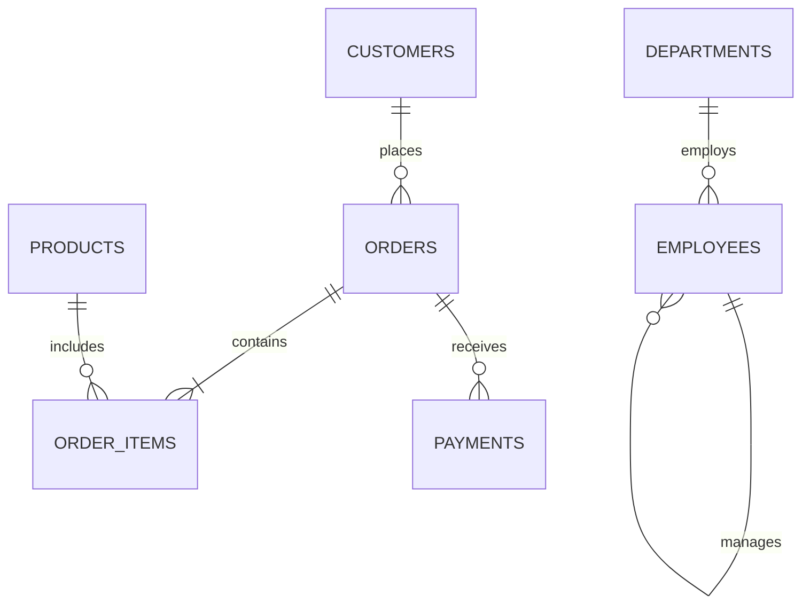

# PostgreSQL — SQL Practice & Self-Study


A personal PostgreSQL learning repository with **150 SQL practice problems**, organized into beginner, intermediate, and advanced levels. The exercises use a sample retail-company database and include example queries and expected results.

## Table of Contents

- [Project Overview](#project-overview)
- [Technologies](#technologies)
- [Repository Structure](#repository-structure)
- [Practice Topics](#practice-topics)
- [Sample Database](#sample-database)
- [Getting Started](#getting-started)
- [Study Workflow](#study-workflow)
- [Author](#author)

## Project Overview

This repository documents my self-study of PostgreSQL and SQL for data analytics, business intelligence, and database management. The accompanying exercises progress from basic querying to analytical SQL and PostgreSQL programming.

## Technologies

- PostgreSQL 16 (used for the exercise results)
- SQL
- Visual Studio Code / PostgreSQL client
- Markdown and GitHub

## Repository Structure

```text
PostgreSQL-Practice/
├── README.md
├── 00_setup.sql
└── PostgreSQL_150_Practice_Problems.md
```

| File | Purpose |
|---|---|
| [`00_setup.sql`](00_setup.sql) | Create and populate the sample database |
| [`PostgreSQL_150_Practice_Problems.md`](PostgreSQL_150_Practice_Problems.md) | 150 exercises with SQL solutions and expected results |
| `README.md` | Project overview and setup instructions |

## Practice Topics

| Level | Problems | Main topics |
|---|---:|---|
| 🟢 Beginner | 50 (B01–B50) | `SELECT`, `WHERE`, sorting, aggregates, `GROUP BY`, `HAVING`, `CASE`, basic joins, strings and dates |
| 🟡 Intermediate | 50 (I01–I50) | Outer/self joins, subqueries, CTEs, window functions, views, data manipulation, date and text functions |
| 🔴 Advanced | 50 (A01–A50) | Recursive CTEs, advanced windows, JSONB, arrays, procedures, triggers, `MERGE`, cohort and RFM analysis |
| **Total** | **150** | |

**[Open all 150 PostgreSQL practice problems](PostgreSQL_150_Practice_Problems.md)**

## Sample Database

The exercises use a fictional retail business serving customers in the Baltic states and Poland.

| Table | Rows | Description |
|---|---:|---|
| `departments` | 6 | Departments and office locations |
| `employees` | 20 | Employees, salaries and reporting lines |
| `customers` | 16 | Customer contact details and signup dates |
| `products` | 14 | Products, categories, prices and stock |
| `orders` | 48 | Customer orders and shipping statuses |
| `order_items` | 80 | Line items and quantities |
| `payments` | 43 | Payments, dates, amounts and methods |
| **Total** | **227** | |



The sample includes useful edge cases such as customers without orders, unsold products, missing values, cancelled orders, and a duplicated customer identity with differently capitalized email addresses.

## Getting Started

### 1. Clone the repository

```bash
git clone https://github.com/imalgirdas/PostgreSQL-Practice.git
cd PostgreSQL-Practice
```

> Change the URL if you use a different repository name.

### 2. Create the database

With PostgreSQL installed and `psql` available:

```bash
psql -U postgres -d postgres -c "CREATE DATABASE sql_practice;"
```

### 3. Load the sample data

```bash
psql -U postgres -d sql_practice -f 00_setup.sql
```

**Warning:** The setup script drops and recreates the seven sample tables. Run it only in the intended practice database.

### 4. Verify the setup

```sql
SELECT 'departments' AS table_name, COUNT(*) FROM departments
UNION ALL SELECT 'employees', COUNT(*) FROM employees
UNION ALL SELECT 'customers', COUNT(*) FROM customers
UNION ALL SELECT 'products', COUNT(*) FROM products
UNION ALL SELECT 'orders', COUNT(*) FROM orders
UNION ALL SELECT 'order_items', COUNT(*) FROM order_items
UNION ALL SELECT 'payments', COUNT(*) FROM payments;
```

## Study Workflow

1. Open the [practice problems](PostgreSQL_150_Practice_Problems.md).
2. Choose a problem by level and attempt it independently.
3. Run your SQL against the sample database.
4. Compare the output with the documented solution and expected result.
5. Record your own improvements and alternative approaches.

For exercises that change data, use transactions to keep the original dataset intact:

```sql
BEGIN;
-- Practice INSERT, UPDATE, DELETE or another change here.
ROLLBACK;
```

Some advanced exercises intentionally demonstrate errors raised by constraints or triggers. See the exercise notes before running them.

## Author

**Algirdas Vailionis** — Finance & Data Analytics Enthusiast

[GitHub](https://github.com/imalgirdas) · [LinkedIn](https://www.linkedin.com/in/algirdas-vailionis/) · [Email](mailto:algirdas.vailionis@gmail.com)

---

*Personal learning repository for educational and self-study purposes.*
